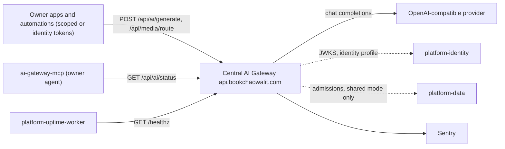
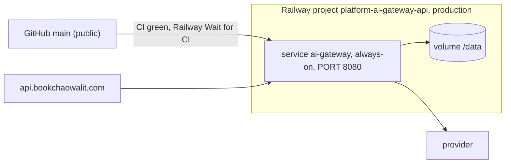

# Central AI Gateway — System Architecture

สรุป architecture ของ `platform-ai-gateway-api` (`solo-empire.ai-gateway.v1`, `https://api.bookchaowalit.com`) จากโค้ดบน `origin/main` `efe8fa9` (2026-11-04) และชุดภาพ Core 22 ใน [`docs/diagrams/`](../docs/diagrams/README.md) (วาดที่ `b8141c9`; 05, 06 และ ADR-0006 อัปเดตสำหรับ identity profile ที่ merge 2026-11-04) รายละเอียดอยู่ในไฟล์ที่ลิงก์

## 1. Architecture style และเหตุผล

- **Single-process gateway service (API gateway pattern สำหรับ LLM)**: Node 22 `node:http` ตัวเดียว รวม auth, rate limit, monthly budget, Thai-first policy, provider call พร้อม fallback หนึ่งครั้ง และ media routing ([ADR-0001](../docs/diagrams/08-adr/ADR-0001-node-standalone-service-extracted-from-monorepo.md))
  - เหตุผล: ให้ทุก app เรียกโมเดลผ่าน endpoint เดียวที่คุม scope และค่าใช้จ่าย แทนการถือ provider key เอง
- **Stateful บน volume**: telemetry และยอด budget อยู่ใน SQLite บน Railway volume `/data` จึงต้อง always-on ([ADR-0002](../docs/diagrams/08-adr/ADR-0002-railway-always-on-with-sqlite-volume.md))
- **Pluggable auth profiles** เลือกด้วย `AI_GATEWAY_AUTH_PROFILE`: `scoped` (default, [ADR-0003](../docs/diagrams/08-adr/ADR-0003-scoped-hashed-tokens-fail-closed.md)), `workspace-jwt` + shared admission ([ADR-0004](../docs/diagrams/08-adr/ADR-0004-staged-workspace-jwt-and-shared-admission.md)), `identity` ([ADR-0006](../docs/diagrams/08-adr/ADR-0006-identity-profile-platform-identity-jwks.md))
- **Fail closed** ทุกจุด: config ผิด, budget ไม่ได้ตั้ง, limiter ใช้ไม่ได้ → 503 แทนการปล่อยผ่าน

## 2. Quality-attribute scenarios

| Attribute | Scenario (stimulus → response) | Measure | หลักฐาน / guard |
|---|---|---|---|
| Security: authn | token ผิด scope / legacy / JWT ผิด issuer หรือ audience → ปฏิเสธ, JWT ไม่ fallback ไป static | 401/403 | `tests/auth.test.ts`, `tests/identity_auth.test.ts`, `tests/ai_gateway_service.test.ts` |
| Cost control | ยอดเดือนถึง budget → `monthly_budget_exceeded`; budget ไม่ได้ตั้ง → 503 `budget_not_configured` | ไม่มี call เกิน budget | `api/ai_budget.ts`, `tests/ai_budget.test.ts`; budget persist ข้าม restart (service test) |
| Fairness | subject ยิงเกิน rate → 429 + `Retry-After`; limiter config ผิด → 503 | per-subject | `api/ai_rate_limit.ts`, `tests/ai_rate_limit.test.ts` |
| Availability: provider | provider ตอบ 5xx หรือ timeout → fallback model หนึ่งครั้ง | `fallback_used` ใน telemetry | `api/ai_gateway.ts`, service tests (5xx, timeout) |
| Privacy | request `privacy_class: private` → 403; telemetry ไม่เก็บ content | content-free rows | service tests; `restricted` ยังไม่มี assertion (gap) |
| Privacy: telemetry | error → Sentry แบบ scrubbed | scrub tests | `tests/sentry.test.ts` |
| Durability | restart / redeploy → telemetry และยอด budget ยังอยู่ | SQLite WAL, `synchronous FULL` บน volume | `api/ai-gateway-service/store.ts`; **ไม่มี backup** ([14-backup-dr.md](../docs/diagrams/14-backup-dr.md)) |

ไม่มี latency/throughput SLO ที่กำหนดใน repo

## 3. Context diagram

ภาพเต็ม: [05-c4-context.md](../docs/diagrams/05-c4-context.md)

edge gateway `gateway.bookchaowalit.com` ไม่อยู่ใน path ของ service นี้ (05 open questions)

## 4. Components / containers

ภาพ container: [06-c4-container.md](../docs/diagrams/06-c4-container.md); component: [07-c4-component.md](../docs/diagrams/07-c4-component.md)

| Container / module | หน้าที่ | หลักฐาน |
|---|---|---|
| `ai-gateway` service (`dist/server.mjs`, esbuild bundle) | HTTP routes `/healthz`, `/readyz`, `/api/ai/status`, `/api/ai/generate`, `/api/media/route` | `api/ai-gateway-service/main.ts`, `service.ts` |
| `api/auth.ts`, `workspace_auth.ts`, `identity_auth.ts` | สาม auth profiles | ADR-0003/0004/0006 |
| `api/ai_rate_limit.ts`, `api/ai_budget.ts` | per-subject limit, monthly budget | — |
| `api/ai_gateway.ts` | Thai-first policy, provider call, fallback, telemetry record | — |
| `api/media_router.ts` | ตัดสินเส้นทาง media | — |
| `api/ai_shared_admission.ts` | reserve/settle กับ platform-data (ปิด default) | `docs/shared-admission.md` |
| Telemetry store | SQLite `node:sqlite`, ตาราง `ai_run_telemetry` | `store.ts`, `database/migrations/025_ai_run_telemetry.sql` |
| `ai-gateway-mcp` | stdio MCP, 3 read-only tools บน `/api/ai/status` | `mcp/ai-gateway-mcp.ts` |

## 5. Tech stack

| ชั้น | เทคโนโลยี |
|---|---|
| Runtime | Node ≥ 22.13, `node:http`, `node:sqlite`, `jose` (JWT/JWKS), `zod`, MCP SDK |
| Build | TypeScript 7, esbuild bundle, Docker `node:22-slim` 2-stage |
| Test | `node:test` ผ่าน `tsx --test` (ไม่มี coverage report) |
| Deploy | Railway (`railway.json`: healthcheck `/healthz` 60 s, restart ON_FAILURE ×10) |
| CI | `platform-ci-workflows` v1.1.1 `ci-node.yml` + `security.yml`; `shared-runtime.yml` (postgres:16 + platform-data) |

## 6. Data stores

| Store | ข้อมูล | หลักฐาน |
|---|---|---|
| SQLite `/data/ai-gateway.sqlite` บน Railway volume | `ai_run_telemetry` (subject, model, tokens, cost, status, `fallback_used`, ไม่มี content); month-to-date SUM สำหรับ budget | `store.ts`, [09-erd.md](../docs/diagrams/09-erd.md) |
| platform-data (ภายนอก, staged) | durable shared admissions | ADR-0004 |
| Neon project `platform-ai-gateway-api` | ตาม commit `723d752` มี project แต่โค้ดไม่ใช้ Postgres | open question |

## 7. Integrations

| ระบบ | ทิศทาง | ใช้ทำอะไร | หลักฐาน |
|---|---|---|---|
| Identity / JWKS | gateway → platform-identity `/.well-known/jwks.json` (identity profile) | verify RS256 aud `ai-api` | `api/identity_auth.ts`, ADR-0006 |
| empire-platform | ไม่มีการเรียกตรง; scope `ai:read` / `ai:generate` map อยู่ที่ empire-platform `permissions.py` | identity mint scope หลัง PDP | empire-platform commit `16b5349` |
| OpenAI-compatible provider | ออก HTTPS (`AI_GATEWAY_BASE_URL`) | generation | `api/ai_gateway.ts` |
| platform-data | ออก (shared mode only) | admissions | `api/ai_shared_admission.ts` |
| Sentry | ออก (เมื่อตั้ง `SENTRY_DSN`), release = `RAILWAY_GIT_COMMIT_SHA` | errors | `api/ai-gateway-service/sentry.ts` |
| platform-uptime-worker | เข้า `GET /healthz` | monitoring | [20-observability.md](../docs/diagrams/20-observability.md) |
| API gateway edge | ไม่อยู่ใน path | — | ops record api-gateway-edge |
| Neon / R2 / Queues / Kafka | ไม่ใช้ในโค้ด | — | not_applicable |

## 8. Deployment topology

ภาพเต็ม: [16-deployment.md](../docs/diagrams/16-deployment.md); pipeline: [15-cicd-pipeline.md](../docs/diagrams/15-cicd-pipeline.md)

- secrets อยู่ใน Railway variables เท่านั้น (ชื่อเช่น `API_TOKENS_JSON`, `AI_GATEWAY_BASE_URL`, `AI_GATEWAY_AUTH_PROFILE`, `AI_GATEWAY_IDENTITY_ISSUER`, `SENTRY_DSN`)
- deploy ของ `b8141c9` ไม่ถึง `success`; ณ เวลาที่วาด 16 production อยู่ที่ `a9843e8` — สถานะของ `efe8fa9` ไม่ได้ตรวจ

## 9. ADR สำคัญ

| ID | การตัดสินใจ | ไฟล์ |
|---|---|---|
| ADR-0001 | Standalone Node service แยกจาก monorepo | [ADR-0001](../docs/diagrams/08-adr/ADR-0001-node-standalone-service-extracted-from-monorepo.md) |
| ADR-0002 | Railway always-on + SQLite telemetry บน volume | [ADR-0002](../docs/diagrams/08-adr/ADR-0002-railway-always-on-with-sqlite-volume.md) |
| ADR-0003 | Scoped SHA-256 token hashes, fail closed | [ADR-0003](../docs/diagrams/08-adr/ADR-0003-scoped-hashed-tokens-fail-closed.md) |
| ADR-0004 | Staged workspace JWT + shared admission (ปิด default) | [ADR-0004](../docs/diagrams/08-adr/ADR-0004-staged-workspace-jwt-and-shared-admission.md) |
| ADR-0005 | Shared CI v1.1.1 + Railway Wait for CI | [ADR-0005](../docs/diagrams/08-adr/ADR-0005-shared-ci-and-railway-wait-for-ci.md) |
| ADR-0006 | Identity profile: platform-identity tokens (aud `ai-api`, JWKS) คู่กับ static tokens | [ADR-0006](../docs/diagrams/08-adr/ADR-0006-identity-profile-platform-identity-jwks.md) |

Central: architecture-docs `systems/ai-data/central-ai-gateway.md`

## 10. Fitness functions

| Guard | สิ่งที่ปกป้อง | ที่รัน |
|---|---|---|
| `tests/auth.test.ts`, `tests/identity_auth.test.ts` | ADR-0003, ADR-0006 | CI `gateway` (`ci-node.yml`, `npm test` require-tests) |
| `tests/ai_budget.test.ts`, `tests/ai_rate_limit.test.ts` | cost + fairness | CI |
| `tests/ai_gateway_service.test.ts` (loopback service + fake provider) | fallback, privacy, body limits, telemetry migration | CI |
| `tests/ai_shared_admission_test.ts`, `ai_shared_data_integration_test.ts` | ADR-0004 | `shared-runtime.yml` (postgres:16 + platform-data) |
| `tests/sentry.test.ts` | scrubbing | CI |
| `tests/ai_gateway_mcp.test.ts` | MCP read-only | CI |
| typecheck + `npm run build` | build integrity | CI |
| gitleaks, semgrep, osv-scanner, trivy-fs | secrets, SAST, dependencies (เคยบล็อก deploy `77e8d12`) | CI `security.yml` |
| Railway healthcheck `/healthz` + Wait for CI | ADR-0005 | Railway |

Gaps: ไม่มี coverage gate, ไม่มี e2e/container test, `restricted` privacy class ([17-test-coverage-matrix.md](../docs/diagrams/17-test-coverage-matrix.md))

## 11. เอกสารลงรายละเอียด (SDLC phase 07)

tier ของ pack นี้คือ L0 จึงยังไม่บังคับ; ตารางนี้ชี้สิ่งที่มีอยู่แล้ว

| Template (architecture-docs) | สถานะ | ไฟล์ / เหตุผล |
|---|---|---|
| `sdlc/infrastructure-and-network-design.md` | partial (ภาพ) | [16-deployment.md](../docs/diagrams/16-deployment.md), [19-service-dependency-map.md](../docs/diagrams/19-service-dependency-map.md) |
| `sdlc/observability-design.md` | partial (ภาพ) | [20-observability.md](../docs/diagrams/20-observability.md) |
| `sdlc/capacity-performance-and-cost-plan.md` | partial (โค้ด) | budget + rate limit ใน `api/ai_budget.ts`, `api/ai_rate_limit.ts`; ไม่มี load test |
| `sdlc/failure-mode-analysis.md` | partial (ภาพ) | [13-threat-model.md](../docs/diagrams/13-threat-model.md), [14-backup-dr.md](../docs/diagrams/14-backup-dr.md), [21-incident-response.md](../docs/diagrams/21-incident-response.md) |
| `sdlc/async-integration-contract.md` | not_applicable | request/response เท่านั้น; shared admission เป็น synchronous HTTP |
| `sdlc/frontend-architecture.md` | not_applicable | ไม่มี UI |
| `sdlc/tech-debt-register.md` | not created | ที่พบ: ไม่มี backup ของ SQLite, ไม่มี coverage gate, Neon project ไม่ได้ใช้ |
| `operations/system-landscape.md` | central | architecture-docs `systems/ai-data/central-ai-gateway.md` **[ต้องยืนยัน]** ว่าเป็นปัจจุบัน |
| `development-cycle/vendor-dependency-review.md` | not created | vendor: Railway, LLM provider, Sentry |

## 12. Open questions

- **AI platform decision**: commit `eee3d57` และ `docs/identity-tokens.md` อ้าง owner decision 2026-11-04 ว่า gateway นี้คือ ai service และ `platform-ai` ถูกปลด; brief ฝั่ง portfolio ยังถือว่าเปิด — owner ยืนยัน (เอกสารนี้ไม่ตัดสิน)
- production ใช้ auth profile ใด และ deployment ของ `efe8fa9` ผ่าน approval gate แล้วหรือยัง
- provider และ fallback model จริงใน production (Railway variables); gateway OpenAI key ถูก revoke ตาม ops record 2026-10-28/11-04
- backup ของ SQLite volume; RTO/RPO
- Neon project `platform-ai-gateway-api` ควรลบหรือไม่
- ปลด static tokens, ย้าย org `bookchaowalit-backend`, always-on vs serverless (`docs/identity-tokens.md`)
- Railway Wait for CI รอ `Shared admission` check ด้วยหรือไม่

## การอนุมัติ

| บทบาท | สถานะ | วันที่ | ลงนาม |
|---|---|---|---|
| Solution Architect (Book Dev) | รอตรวจ | — | [ต้องยืนยัน] |
| Product owner | รอพิจารณา | — | ________ |

## แหล่งข้อมูล

อ่านที่ `origin/main` `efe8fa9` (2026-11-04):

- `README.md`, `PRODUCT.md`, `AGENTS.md`, `package.json`, `railway.json`, `Dockerfile`
- `api/ai-gateway-service/service.ts`, `api/identity_auth.ts`, `api/ai_gateway.ts`, รายชื่อ `api/*.ts`
- `docs/identity-tokens.md`, `docs/shared-admission.md`
- `docs/diagrams/*` (Core 22 pack ที่ `b8141c9`), `docs/diagrams/08-adr/*`
- `git log` commits `eee3d57`, `24e066f`, `efe8fa9`; empire-platform `16b5349`
- ops records: api-gateway-edge, railway-deploy-approval-gate, heartbeat-failures-2026-11-04
