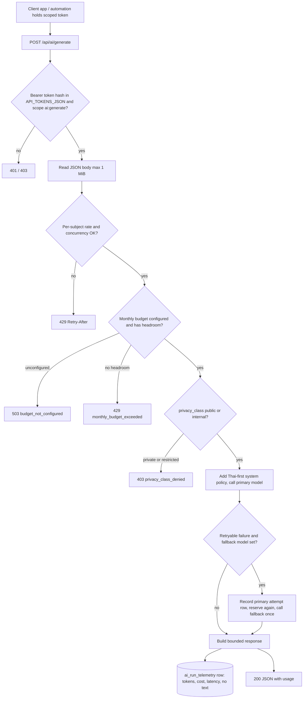
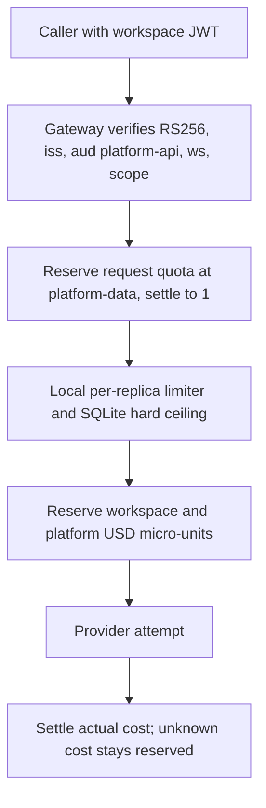

# 01 — Business process (As-Is / To-Be)

repo นี้คือ **Central AI Gateway** ที่ deploy จริง (`solo-empire.ai-gateway.v1`, `https://api.bookchaowalit.com`): Node service ตัวเดียวที่รับ model call จาก app/automation ของ owner ผ่าน scoped bearer token, บังคับ privacy class, rate limit และ monthly budget แล้วส่งต่อไปยัง OpenAI-compatible provider และบันทึก telemetry ที่ไม่มี prompt/output ลง SQLite บน Railway volume

## As-Is (จาก code วันนี้, `origin/main` `b8141c9`)

กระบวนการรอง: `POST /api/media/route` เลือก STT provider และ summary profile จาก `platform/media-transcription-routing.json` จาก metadata อย่างเดียว (ไม่ถอดเสียงเอง) และ `GET /api/ai/status` ให้สถานะ config/budget/rate limit ซึ่ง MCP server `ai-gateway-mcp` อ่านแบบ read-only

ลูกค้าที่ยืนยันได้จาก ops record: cron `sheet-summaries` เรียก route `sheet-summaries` profile `fast` และ gateway มี cap $5/เดือน (`LLM_LAB_MONTHLY_BUDGET_USD`) ที่ทุก client ใช้ร่วมกัน (ops record: sheet-summaries-cron (2026-11-03))

Sources: `api/ai-gateway-service/service.ts`, `api/ai_gateway.ts`, `api/auth.ts`, `api/ai_rate_limit.ts`, `api/ai_budget.ts`, `api/media_router.ts`, `api/ai-gateway-service/store.ts`, `README.md`, `PRODUCT.md`

## To-Be (จาก repo docs เท่านั้น)

`docs/shared-admission.md` บรรยายโหมด staged ที่ merge แล้วแต่ **ยังไม่เปิดใน production** (`AI_GATEWAY_AUTH_PROFILE=workspace-jwt` + `AI_GATEWAY_ADMISSION_MODE=shared`): caller ใช้ workspace JWT (RS256, audience `platform-api`) และทั้ง rate และ USD budget ถูก reserve/settle ที่ platform-data ก่อนทุก provider attempt เพื่อรองรับหลาย replica

Sources: `docs/shared-admission.md`, `api/workspace_auth.ts`, `api/ai_shared_admission.ts`

## Open questions

- Release preflight 5 ขั้นใน `docs/shared-admission.md` ยังไม่ทำใน production: จะเปิด shared mode เมื่อไรและใครอนุมัติ
- ops record: book-platforms-status (2026-11-03) บันทึกว่า owner ยังต้องตัดสิน: ย้าย gateway เป็น service `ai` (audience `ai-api` ผ่าน JWKS), always-on vs serverless+Neon, เลิก static token และ cutover; repo นี้ไม่มี spec ของ To-Be นั้น
- client ใดถือ token อยู่บ้างวันนี้ (`PRODUCT.md` ระบุ `[ต้องยืนยัน]`)
