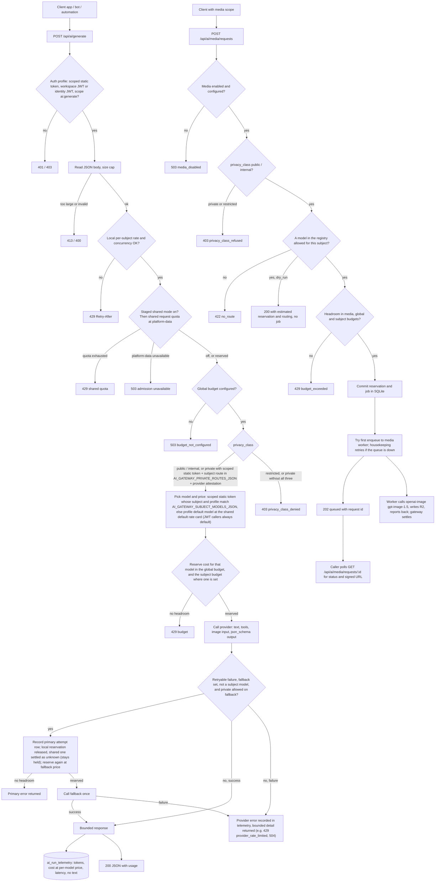
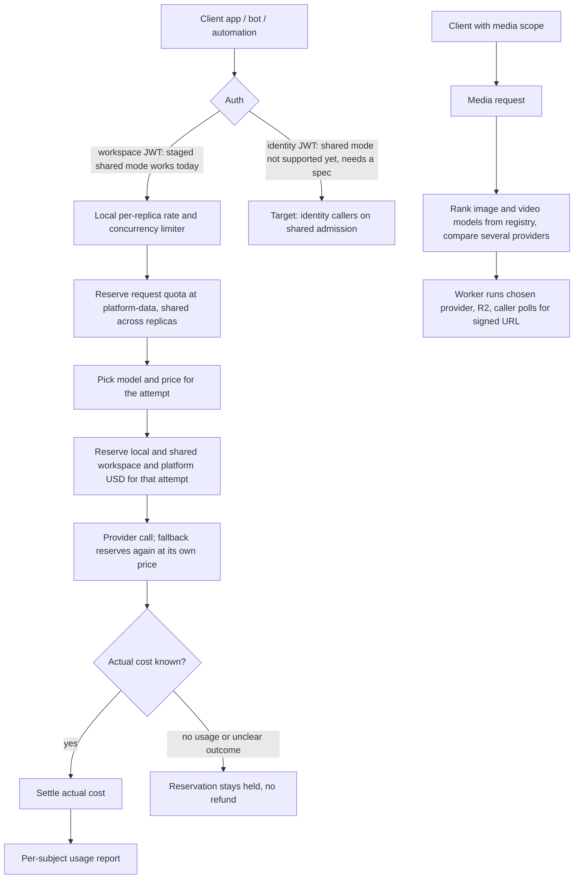

# 01 — Business process (As-Is / To-Be)

repo นี้คือ **Central AI Gateway** ที่ deploy จริง (`solo-empire.ai-gateway.v1`, `https://api.bookchaowalit.com`): Node service ตัวเดียวที่รับ model call จาก app/automation ของ owner, บังคับ auth, privacy class, rate limit และ monthly budget ต่อ subject แล้วส่งต่อไปยัง OpenAI-compatible provider และบันทึก telemetry ที่ไม่มี prompt/output ลง SQLite บน Railway volume ตั้งแต่ SPEC-003 P1a มีงานสร้างภาพผ่าน media worker (Cloudflare) ด้วย แต่ปิดไว้จนกว่าจะตั้ง `AI_GATEWAY_MEDIA_ENABLED`

Last reviewed: 2026-11-26 · commit `ca86f75`

## As-Is (จากโค้ดวันนี้)

กระบวนการรอง: `POST /api/media/route` เลือก STT provider และ summary profile จาก `platform/media-transcription-routing.json` (metadata อย่างเดียว) และ `GET /api/ai/status` ให้สถานะ config, budget, rate limit และ media ซึ่ง MCP `ai-gateway-mcp` อ่านแบบ read-only

Sources: `api/ai-gateway-service/service.ts` (routes `/healthz`, `/readyz`, `/api/ai/status`, `/api/ai/generate`, `/api/media/route`), `api/media/http.ts` (`/api/ai/media/requests`, `/api/ai/media/models`), `api/ai_gateway.ts` (subject models, private routes), `api/ai_tools.ts`, `api/workspace_auth.ts`, `api/identity_auth.ts`, `api/ai_budget.ts`, `api/ai_rate_limit.ts`, `api/media/jobs.ts`, commits `cf01ce4` (SPEC-004), `3a09c24` (openai-image)

> ไดอะแกรมนี้เป็นภาพสรุปของกระบวนการ ไม่ได้ครอบทุก error code; โค้ดและเทสใน `api/` คือแหล่งจริง

## To-Be (จาก docs/shared-admission.md, specs/003-media-generation และ ops record)

Sources: `docs/shared-admission.md` (staged shared mode, merged, not on in production; `service.ts` refuses shared mode unless `AI_GATEWAY_AUTH_PROFILE=workspace-jwt`), `api/ai_shared_admission.ts`, `specs/003-media-generation/spec.md` (multi-provider pipeline, Q1–Q4 open), ops record: book-platforms-status (2026-11-03, move to service `ai`), ops record: openai-single-key (2026-11-09, no per-subject report yet)

## Gap

| ID | As-Is → To-Be | Status | Owner | Evidence |
|---|---|---|---|---|
| G1 | plain text only → tools, image input, json_schema, private routes for client bots | done | claude | `specs/002-tools-vision/spec.md`, `api/ai_tools.ts` |
| G2 | one model per profile → model and price per subject | done | claude | `specs/004-subject-models/spec.md`, commit `cf01ce4` |
| G3 | no media generation → image generation through media worker (P1a) | blocked | owner | `specs/003-media-generation/spec.md` P1a merged; media off until owner answers Q1/Q2 and sets the R2 token |
| G4 | one image provider → ranked multi-provider image and video pipeline (P1b+) | todo | claude | `specs/003-media-generation/spec.md` phases after P1a |
| G5 | local per-replica limits, legacy admission → shared admission at platform-data | decide | owner | `docs/shared-admission.md` release preflight not run in production |
| G6 | static scoped tokens → JWT only, move to service `ai` (audience `ai-api`) | decide | owner | ops record: book-platforms-status (2026-11-03); no spec yet |
| G7 | telemetry per call → per-subject usage report | todo | claude | ops record: openai-single-key (2026-11-09) |
| G8 | shared admission only with workspace JWT → identity JWT callers on shared admission | todo | claude | `api/ai-gateway-service/service.ts` refuses shared mode with `AI_GATEWAY_AUTH_PROFILE=identity`; needs a spec |

## Open questions

- จะเปิด shared admission เมื่อไรและใครอนุมัติ release preflight 5 ขั้น (`docs/shared-admission.md`)
- ย้าย gateway เป็น service `ai` และเลิก static token หรือไม่ (G6) ต้องมี spec ก่อน
- client ใดถือ token อยู่บ้างวันนี้ (`PRODUCT.md` ระบุ `[ต้องยืนยัน]`)
