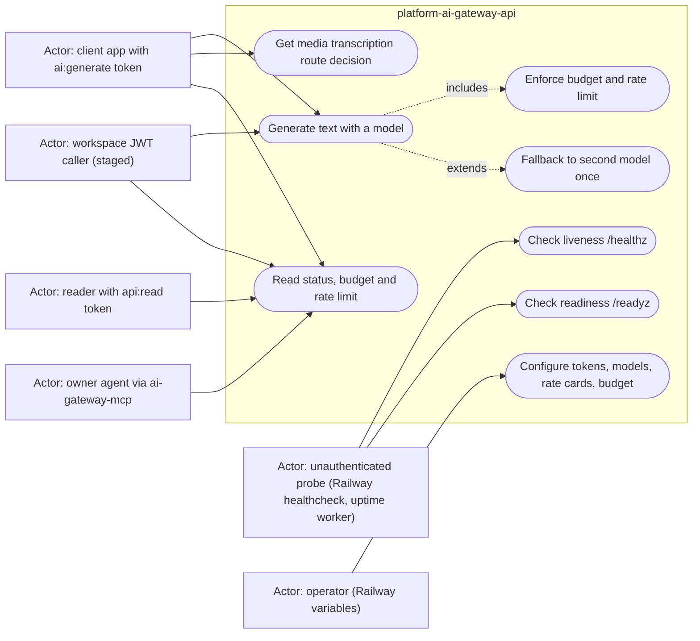

# 02 — Use cases

actors คือ auth level ที่ code รู้จักจริง: scoped token ที่มี scope `api:read` หรือ `ai:generate` (`api/auth.ts`), workspace JWT (staged, `api/workspace_auth.ts`), service JWT `quotas:service` ที่ gateway ใช้เรียก platform-data, ผู้เรียกที่ไม่ auth (`/healthz`, `/readyz`) และ operator ที่ตั้ง Railway variables

หมายเหตุ scope: `api:write` ครอบ `api:read` และ token ที่มี `*` ผ่านทุก scope (`scopeAllows` ใน `api/auth.ts`); `/api/media/route` ใช้ scope `ai:generate` เหมือน generate; MCP server เรียกได้แค่ `GET /api/ai/status` (สาม tool `ai_gateway.status`, `ai_gateway.budget`, `ai_gateway.rate_limit`)

Sources: `api/auth.ts`, `api/workspace_auth.ts`, `api/ai_shared_admission.ts`, `api/ai-gateway-service/service.ts`, `mcp/ai-gateway-mcp.ts`, `railway.json`, `README.md`

## Open questions

- ใครเป็น subject ของ token จริงใน `API_TOKENS_JSON` (เห็นเพียงตัวอย่าง `ev3-web` ใน `api/ai_rate_limit.ts`)
