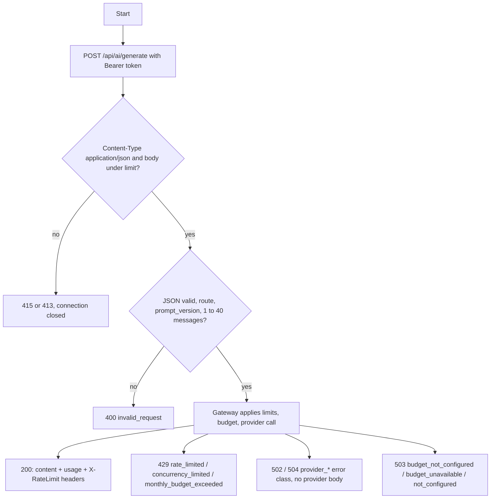
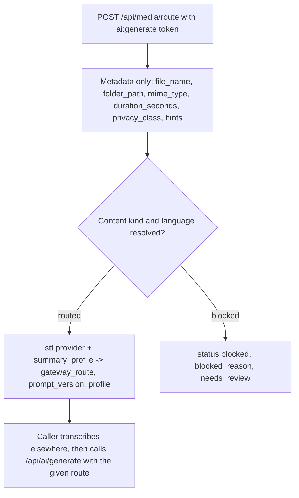
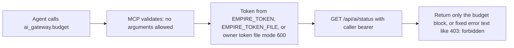
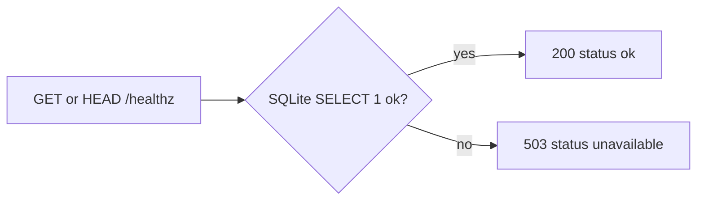

# 03 — User flows (per role)

ไม่มี UI: "user" คือ caller ฝั่ง server ทุก flow มาจาก route ใน `api/ai-gateway-service/service.ts` (CORS ไม่เปิดโดยตั้งใจ)

## Client app: generate

## Client app: media route

## Owner agent: status via MCP

## Probe: health

Sources: `api/ai-gateway-service/service.ts`, `api/ai_gateway.ts` (`validateRequest`), `api/media_router.ts`, `platform/media-transcription-routing.json`, `mcp/ai-gateway-mcp.ts`, `README.md`

## Open questions

- caller ใดใช้ `/api/media/route` ใน production (ops record: meeting-minutes-service ไม่ได้ระบุว่าเรียก gateway)
