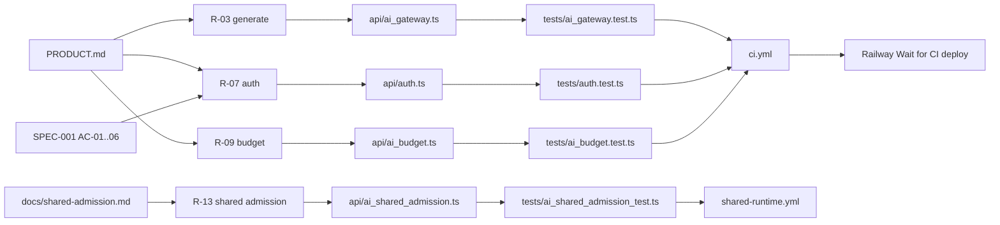

# 04 — Traceability (RTM)

requirement มาจาก `PRODUCT.md` (Capabilities and Constraints), `specs/001-l2-baseline/spec.md` (AC-01..AC-06) และ `docs/shared-admission.md`; release คือ workflow ใน `.github/workflows/` และ Railway Wait for CI deploy ของ `main`

| Req ID | Requirement (source) | Code module | Test file | Release / workflow |
|---|---|---|---|---|
| R-01 | `GET\|HEAD /healthz` ไม่ต้อง auth, 503 เมื่อ store ใช้ไม่ได้ (PRODUCT.md) | `api/ai-gateway-service/service.ts`, `store.ts` | `tests/ai_gateway_service.test.ts` ("healthz is unauthenticated…") | `ci.yml` gateway job; Railway healthcheck `/healthz` (`.railway/railway.ts`) |
| R-02 | `GET /api/ai/status` scope `api:read`, ไม่เปิด provider key (PRODUCT.md) | `service.ts`, `api/ai_gateway.ts` `getAiGatewayStatus` | `tests/ai_gateway_service.test.ts`, `tests/ai_gateway.test.ts` ("status exposes only safe…") | `ci.yml` |
| R-03 | `POST /api/ai/generate` scope `ai:generate`, profile fast/balanced/quality, Thai default (PRODUCT.md) | `api/ai_gateway.ts` `generateAi`, `validateRequest` | `tests/ai_gateway.test.ts`, `tests/ai_gateway_service.test.ts` | `ci.yml` |
| R-04 | primary + fallback หนึ่งครั้ง (PRODUCT.md Positioning) | `api/ai_gateway.ts` | `tests/ai_gateway.test.ts` ("falls back once…"), `tests/ai_gateway_service.test.ts` ("fallback covers a primary timeout…") | `ci.yml` |
| R-05 | private/restricted ห้าม hosted generation | `api/ai_gateway.ts` (403) | `tests/ai_gateway_service.test.ts` ("provider errors return bounded JSON…" asserts 403 for `private`); media: `tests/media_router.test.ts` ("private media never routes…"); `restricted` ไม่มี assert แยก | `ci.yml` |
| R-06 | `POST /api/media/route` metadata-only (PRODUCT.md) | `api/media_router.ts`, `platform/media-transcription-routing.json` | `tests/media_router.test.ts`, `tests/ai_gateway_service.test.ts` ("media route endpoint…") | `ci.yml` |
| R-07 | Scoped token only, fail closed on bad config, refuse start without token (PRODUCT.md, SPEC-001 AC-01..06) | `api/auth.ts`, `service.ts` `serviceConfigurationProblems` | `tests/auth.test.ts` (AC-01..AC-06), `tests/ai_gateway_service.test.ts` ("refuses legacy full-access…") | `ci.yml` |
| R-08 | Rate limit per subject → 429 (PRODUCT.md) | `api/ai_rate_limit.ts` | `tests/ai_rate_limit.test.ts`, `tests/ai_gateway_service.test.ts` ("rate limits are env-configurable…") | `ci.yml` |
| R-09 | Monthly budget blocks; missing → 503 (PRODUCT.md) | `api/ai_budget.ts` | `tests/ai_budget.test.ts`, `tests/ai_gateway_service.test.ts` ("fails closed without a monthly budget…", "spend persists across a service restart…") | `ci.yml` |
| R-10 | Telemetry ไม่เก็บ prompt/output (PRODUCT.md) | `store.ts`, `database/migrations/025_ai_run_telemetry.sql` | `tests/ai_gateway_service.test.ts` ("persists content-free telemetry", "migration is idempotent…") | `ci.yml` |
| R-11 | Sentry เมื่อมี `SENTRY_DSN`, tracing off, scrub (PRODUCT.md) | `api/ai-gateway-service/sentry.ts` | `tests/sentry.test.ts` | `ci.yml` |
| R-12 | MCP read-only, ไม่มี identity argument (README, AGENTS.md) | `mcp/ai-gateway-mcp.ts` | `tests/ai_gateway_mcp.test.ts` | `ci.yml` (MCP ไม่ได้ deploy) |
| R-13 | Shared admission staged: workspace JWT, durable reserve/settle (docs/shared-admission.md) | `api/workspace_auth.ts`, `api/ai_shared_admission.ts` | `tests/ai_shared_admission_test.ts`, `tests/ai_shared_data_integration_test.ts` | `shared-runtime.yml` (PostgreSQL 16 + platform-data @2441e9e) |

Sources: `PRODUCT.md`, `specs/001-l2-baseline/spec.md`, `docs/shared-admission.md`, `api/*.ts`, `tests/*.ts`, `.github/workflows/ci.yml`, `.github/workflows/shared-runtime.yml`, `.railway/railway.ts`

## Open questions

- SPEC-001 สถานะ "changes requested" (review 2026-10-24: §1, §4, §6 overclaim) ยังไม่ถูกแก้
- R-05 test ครอบ `private` แต่ไม่มี assert สำหรับ `restricted` ใน generate
- `shared-runtime.yml` ไม่ได้เป็น check ที่ Railway รอหรือไม่ (ดู 15)
