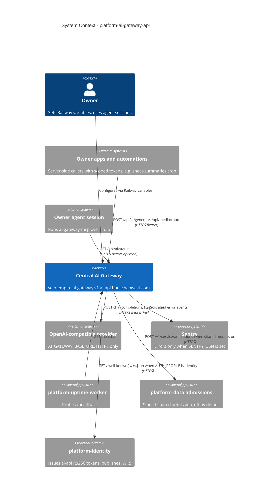

# 05 — C4 Context

Sources: `README.md`, `PRODUCT.md`, `api/ai-gateway-service/service.ts`, `api/ai_gateway.ts`, `api/ai-gateway-service/sentry.ts`, `api/ai_shared_admission.ts`, `mcp/ai-gateway-mcp.ts`, `platform-uptime-worker/src/targets.ts` (target `ai-gateway`), ops record: sheet-summaries-cron (2026-11-03), `api/identity_auth.ts` + `docs/identity-tokens.md` (added 2026-11-04 at `efe8fa9`)

## Open questions

- provider จริงใน production คืออะไร (ops record: railway-deploy-approval-gate (2026-11-03) บอกว่าเป็น OpenAI key) และมี fallback model ตั้งไว้หรือไม่: ค่าอยู่ใน Railway variables ไม่อยู่ใน repo
- edge gateway `gateway.bookchaowalit.com` ข้าม ai-gateway (ops record: api-gateway-edge (2026-11-03)) จึงไม่วาดไว้ใน path
- identity profile (ADR-0006, 2026-11-04) เปิดใน production แล้วหรือยัง (`AI_GATEWAY_AUTH_PROFILE` อยู่ใน Railway variables)
