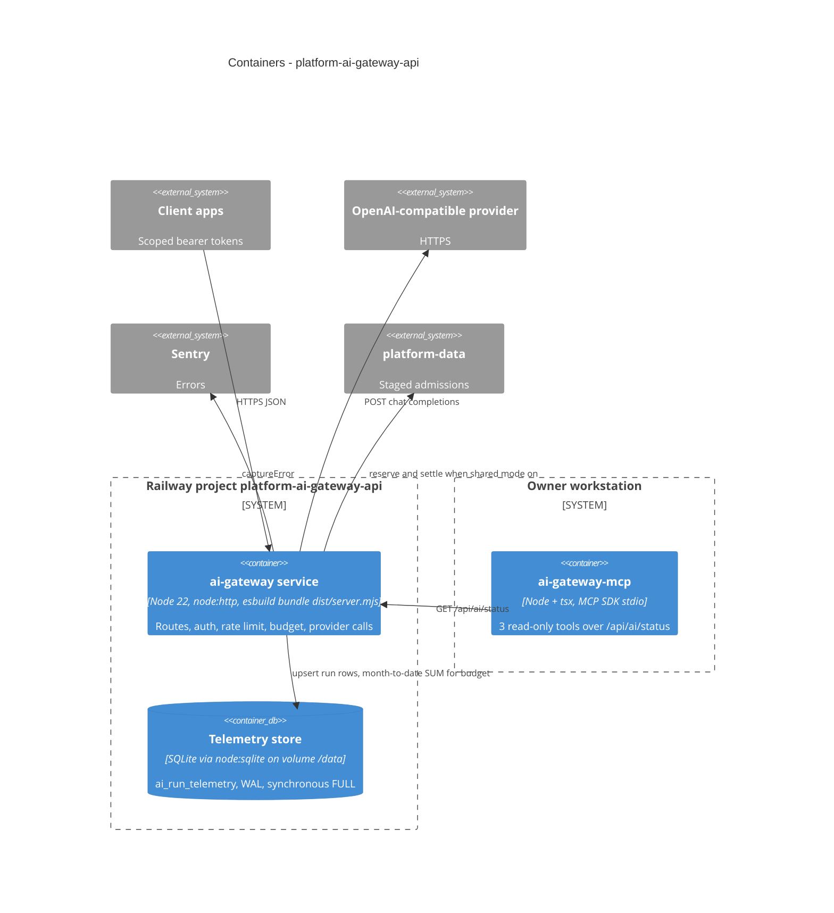

# 06 — C4 Container

Sources: `Dockerfile`, `railway.json`, `api/ai-gateway-service/main.ts`, `api/ai-gateway-service/store.ts`, `api/ai-gateway-service/package.json`, `mcp/ai-gateway-mcp.ts`, `mcp/bin.mjs`, `.mcp.json`, `README.md`

## Open questions

- commit `723d752` บอกว่ามี Neon project ชื่อ `platform-ai-gateway-api` แต่ code ไม่ได้ใช้ Postgres: Neon project นั้นยังใช้อยู่หรือควรลบ
