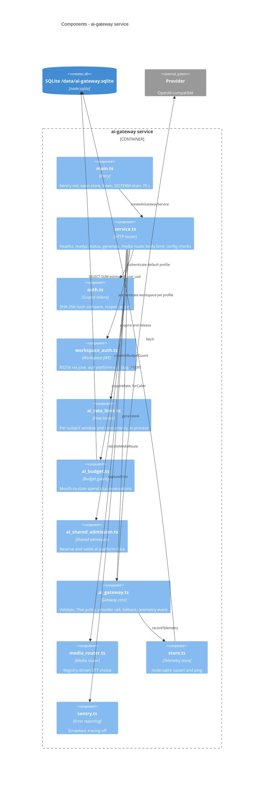

# 07 — C4 Component (ai-gateway service)

Sources: `api/ai-gateway-service/main.ts`, `api/ai-gateway-service/service.ts`, `api/auth.ts`, `api/workspace_auth.ts`, `api/ai_rate_limit.ts`, `api/ai_budget.ts`, `api/ai_shared_admission.ts`, `api/ai_gateway.ts`, `api/media_router.ts`, `api/ai-gateway-service/store.ts`, `api/ai-gateway-service/sentry.ts`
