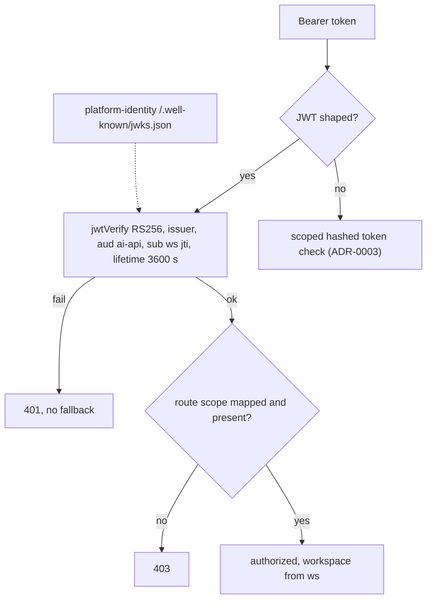

# ADR-0006 — Identity auth profile: platform-identity RS256 tokens (audience `ai-api`, JWKS) next to static tokens

- Status: accepted (retro-documented); code merged, production activation **not confirmed**
- Date: 2026-11-04 (commits `eee3d57`, `24e066f`, merge `efe8fa9`)

## Context

ADR-0003 ใช้ static scoped token (SHA-256 hash ใน `API_TOKENS_JSON`) และ ADR-0004 เตรียม `workspace-jwt` ไว้สำหรับ shared admission; Book Platform services อื่นใช้ token จาก platform-identity ที่ mint shared scope หลัง PDP ของ empire-platform อนุญาต (empire-platform ADR-0007) commit `eee3d57` และ `docs/identity-tokens.md` บันทึกว่า owner ตัดสิน 2026-11-04 ให้ gateway นี้เป็น Book Platform **ai** service (`ai-api`) และปลด scaffold `platform-ai`

## Decision

- เพิ่ม `AI_GATEWAY_AUTH_PROFILE=identity` (ค่าที่รับ: `scoped` default, `workspace-jwt`, `identity`; `service.ts`)
- bearer ที่มีรูปแบบ JWT ตรวจเป็น identity token เท่านั้น: RS256, issuer = `AI_GATEWAY_IDENTITY_ISSUER` (ต้องเป็น https), audience ตรง `ai-api`, ต้องมี `sub`/`ws` เป็น UUID, `iat`, `exp`, `jti`; อายุ ≤ 3600 s, clock tolerance 5 s, ไม่รับ header `crit`, token ≤ 16 KiB (`api/identity_auth.ts`)
- keys ดึงจาก `<issuer>/.well-known/jwks.json` ด้วย `jose` `createRemoteJWKSet` (cooldown 30 s, timeout 5 s)
- JWT ที่ไม่ผ่านไม่ fallback ไป static token; bearer ที่ไม่ใช่ JWT ไปที่ static token เดิม (ใช้ได้คู่กันช่วงย้าย)
- map scope: `api:read` → `ai:read`, `ai:generate` → `ai:generate`; workspace มาจาก claim `ws` เท่านั้น (header/body workspace → 400)
- shared admission ยังต้องใช้ `workspace-jwt`; profile นี้ใช้ local rate limiter + SQLite budget

## Evidence

- `api/identity_auth.ts`, `api/ai-gateway-service/service.ts` (profile validation และ `createIdentityAuthenticator`), `api/auth.ts`
- `docs/identity-tokens.md`
- `tests/identity_auth.test.ts`, `tests/ai_gateway_service.test.ts`
- `package.json` dependency `jose`
- empire-platform `src/empire_platform/permissions.py` (`ai:read` → `ai.status:read`, `ai:generate` → `ai.generation:write`, commit `16b5349`)

## Consequences

- gateway พึ่ง platform-identity สำหรับ key: JWKS ดึงไม่ได้ = identity token ถูกปฏิเสธ (fail closed), static token ยังใช้ได้
- สอง auth path อยู่คู่กันจนกว่าจะปลด static tokens (owner decision ที่ยังเปิด)
- identity profile ไม่รองรับ shared admission; ถ้าต้องการทั้งสองต้องมีการตัดสินใจใหม่

## Open questions

- Railway variable `AI_GATEWAY_AUTH_PROFILE` ของ production ตั้งเป็น `identity` แล้วหรือยัง และ deployment ของ `efe8fa9` ผ่าน approval gate แล้วหรือไม่
- การตัดสินใจ ai platform: repo นี้อ้าง owner decision 2026-11-04 แต่ portfolio brief ยังถือว่าเปิด: owner ยืนยัน
- เมื่อไรปลด static tokens, ย้าย repo ไป org `bookchaowalit-backend`, always-on vs serverless (`docs/identity-tokens.md` "Still open")

Sources: `api/identity_auth.ts`, `api/ai-gateway-service/service.ts`, `docs/identity-tokens.md`, `tests/identity_auth.test.ts`, `git show eee3d57 24e066f`
