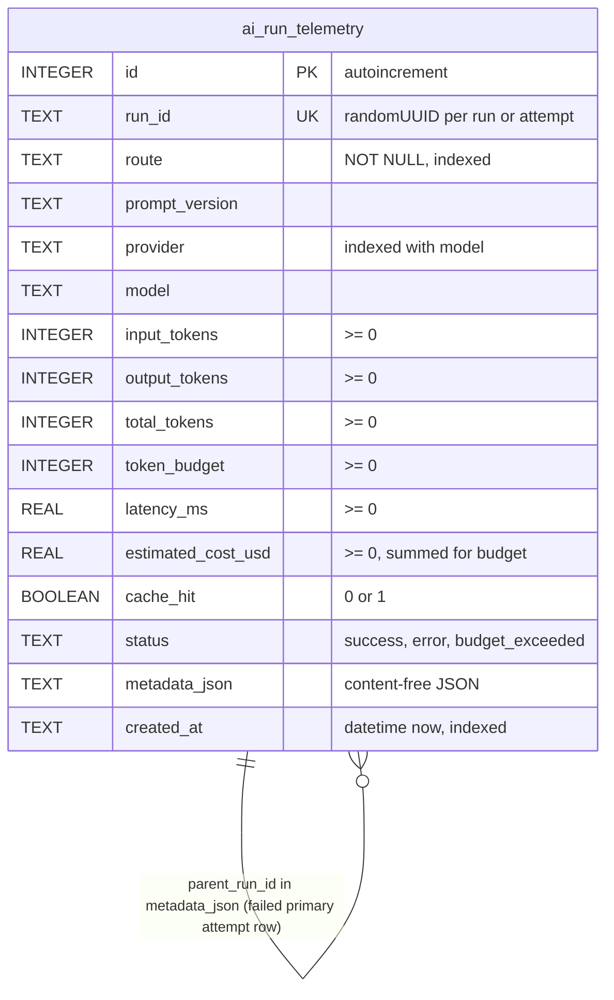

# 09 — ERD

ข้อมูลที่ persist มีตารางเดียว `ai_run_telemetry` (SQLite, `database/migrations/025_ai_run_telemetry.sql`) เก็บ scalar metadata ของแต่ละ run ไม่มี prompt/output; `metadata_json` เก็บ key เช่น `subject`, `workspace_id` (staged), `service`, `profile`, `privacy_class`, `fallback_used`, `primary_model`, `primary_error_class`, `error_class`, `error_cost_policy`, `attempt`, `parent_run_id`

ข้อมูลอื่นที่ไม่ใช่ตาราง: registry แบบ read-only `platform/media-transcription-routing.json` (bundle เข้า image) และ admission state ของ shared mode อยู่ที่ platform-data (ไม่ใช่ของ repo นี้)

Sources: `database/migrations/025_ai_run_telemetry.sql`, `api/ai-gateway-service/store.ts` (`REQUIRED_COLUMNS`, `UPSERT_SQL`), `api/ai_gateway.ts` (`AiTelemetryEvent`, `failureTelemetry`), `api/ai-gateway-service/service.ts` (`withSubject`), `api/ai_budget.ts` (`querySpend`)

## Open questions

- ไม่มี retention/pruning ของ `ai_run_telemetry` ใน code: ตารางโตไม่จำกัด
