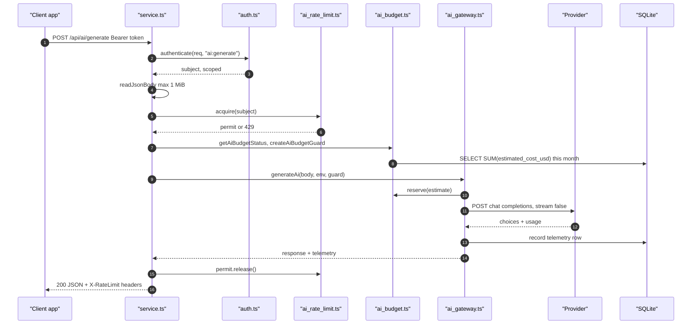
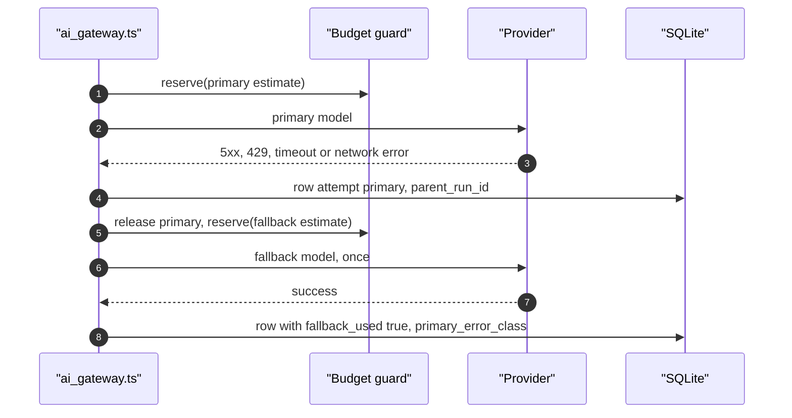
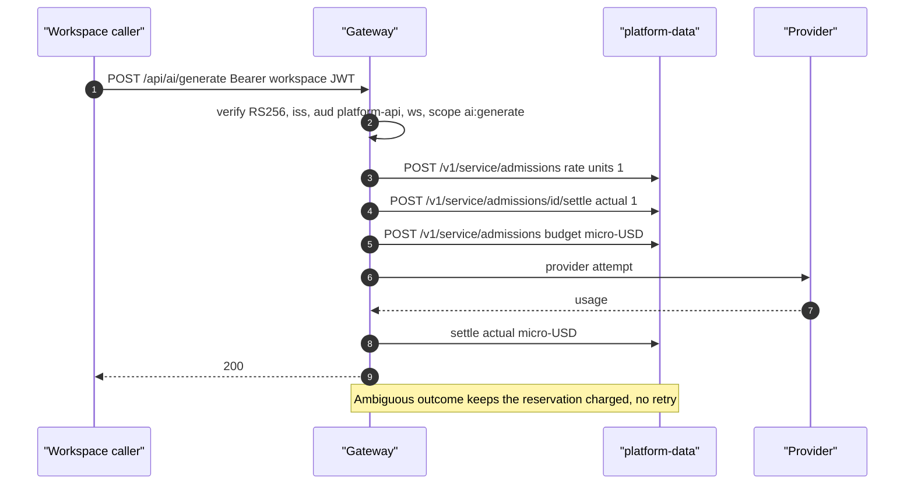
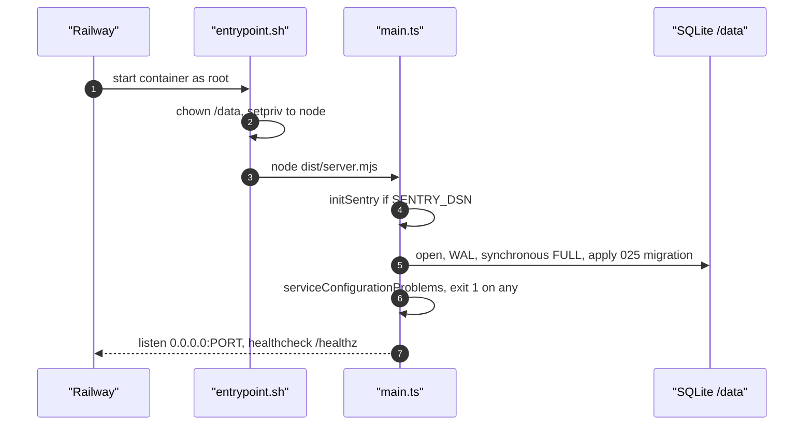

# 10 — Sequences

## 1. Generate (default scoped + legacy admission)

## 2. Primary failure then fallback

## 3. Shared admission (staged, workspace-jwt + shared)

## 4. Startup

Sources: `api/ai-gateway-service/service.ts`, `api/ai_gateway.ts` (`generateAi`, `callProvider`), `api/ai_budget.ts`, `api/ai_rate_limit.ts`, `api/ai_shared_admission.ts`, `api/workspace_auth.ts`, `api/ai-gateway-service/main.ts`, `api/ai-gateway-service/entrypoint.sh`, `api/ai-gateway-service/store.ts`, `railway.json`
