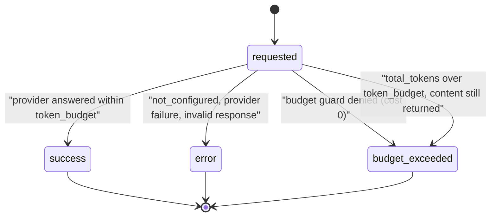
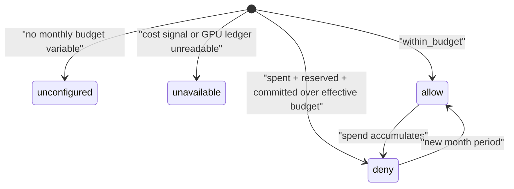
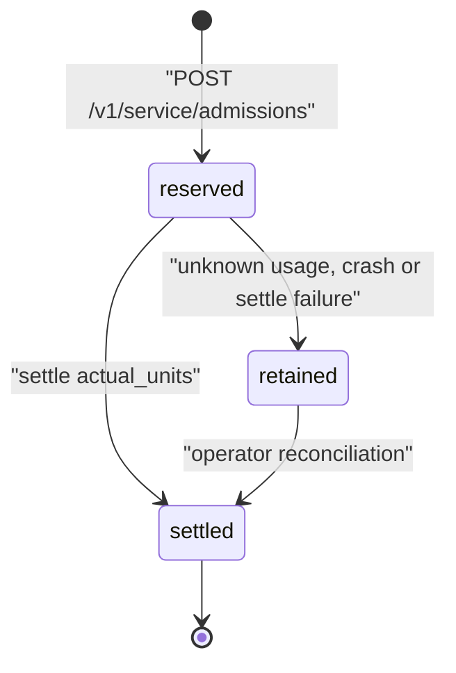
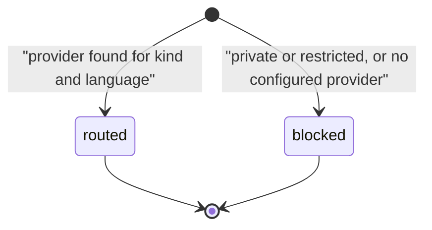

# 11 — State machines

## Telemetry run status (`ai_run_telemetry.status`)

`requested` ไม่ได้ถูกบันทึก (เป็น state ใน memory) ค่าที่ persist มีแค่ `success | error | budget_exceeded`

## Budget decision (`getAiBudgetStatus().decision`)

## Shared admission reservation (staged; state ถือโดย platform-data)

## Media route decision

Sources: `api/ai_gateway.ts` (`AiTelemetryEvent.status`, `telemetryForError`), `api/ai_budget.ts` (`decision`, `reason`), `api/ai_shared_admission.ts` (`reserved`, `settled`), `docs/shared-admission.md` (Durable charge behavior), `api/media_router.ts` (`status`)

## Open questions

- state `retained` เป็นชื่อเชิงอธิบายจาก `docs/shared-admission.md` ("preserve durable reservation charge … operator reconciliation") ไม่ใช่ enum ใน code ของ repo นี้
