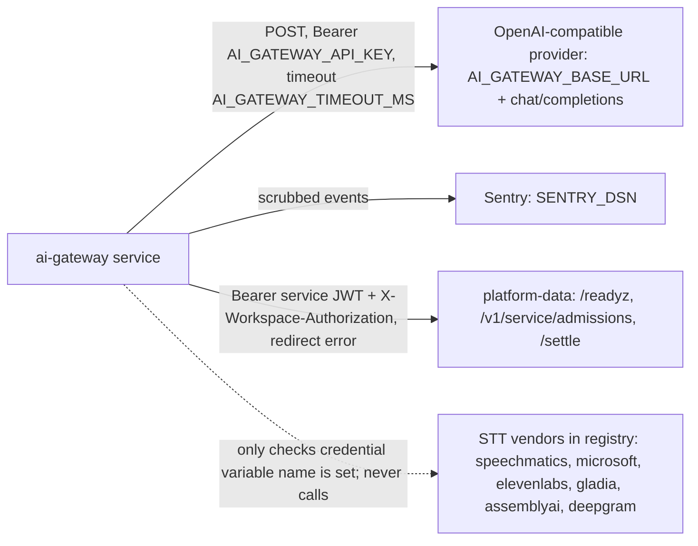

# 12 — API and integrations

## Endpoints (ทั้งหมดใน `api/ai-gateway-service/service.ts`)

| Method | Path | Auth | Response | Notes |
|---|---|---|---|---|
| GET, HEAD | `/healthz` | none | `{status: ok\|unavailable}` 200/503 | SQLite `SELECT 1` เท่านั้น; Railway healthcheck |
| GET, HEAD | `/readyz` | none | `{status: ready\|unavailable, admission_mode}` | ถ้า shared mode: ตรวจ service JWT + platform-data `/readyz` |
| GET | `/api/ai/status` | `api:read` (หรือ `api:write`; `*` ใช้ไม่ได้เพราะ `SCOPE_PATTERN` ใน `api/auth.ts` ปฏิเสธตอน parse) | contract, models, fallback_models, limits, `budget`, `rate_limit`, `service` | ไม่เรียก provider ไม่เปิด key |
| POST | `/api/ai/generate` | `ai:generate` | content + usage; error `{contract, error, code}` | body ≤ 1 MiB (`AI_GATEWAY_MAX_BODY_BYTES` สูงสุด 4 MiB); headers `X-RateLimit-*`, `Retry-After` |
| POST | `/api/media/route` | `ai:generate` | `solo-empire.media-route-decision.v1` | metadata only |
| other | any | — | 404 `not_found` / 405 + `Allow` | |

error `code` ที่ generate คืน: `unauthorized`, `insufficient_scope`, `unsupported_media_type`, `body_too_large`, `invalid_json`, `workspace_override_denied`, `rate_limited`, `concurrency_limited`, `configuration_error`, `budget_not_configured`, `budget_unavailable`, `monthly_budget_exceeded`, `not_configured`, `provider_<class>` (เช่น `provider_timeout`, `provider_auth`), `invalid_request`, `privacy_class_denied`, `gateway_error`, shared: `shared_quota_exhausted`, `shared_admission_unavailable` ฯลฯ

## Request body ของ generate (`AiGenerateRequest`)

`route`, `prompt_version`, `messages[]` (role system/user/assistant), `profile` fast/balanced/quality, `privacy_class` public/internal (private/restricted → 403), `token_budget`, `max_output_tokens`, `temperature`, `response_format` text/json_object, `reasoning_effort`

## External integrations

- Provider URL ต้องเป็น HTTPS (http ได้เฉพาะ loopback และไม่ใช่ production), ห้ามมี credentials/query/fragment
- ไม่มี webhook ขาเข้า
- MCP server `ai-gateway-mcp` เป็น integration ฝั่ง client (stdio) เรียก `GET /api/ai/status` เท่านั้น

Reused (link, not copied): central doc [Central AI Gateway](https://github.com/bookchaowalit/architecture-docs/blob/main/systems/ai-data/central-ai-gateway.md) อธิบาย contract และ service lanes

Sources: `api/ai-gateway-service/service.ts`, `api/ai_gateway.ts` (`AiGenerateRequest`, `endpoint`, URL checks), `api/ai_rate_limit.ts` (`aiRateLimitHeaders`), `api/ai_shared_admission.ts`, `api/media_router.ts`, `platform/media-transcription-routing.json` (`providers`), `api/ai-gateway-service/sentry.ts`, `mcp/ai-gateway-mcp.ts`

## Open questions

- ไม่มี OpenAPI spec ใน repo
