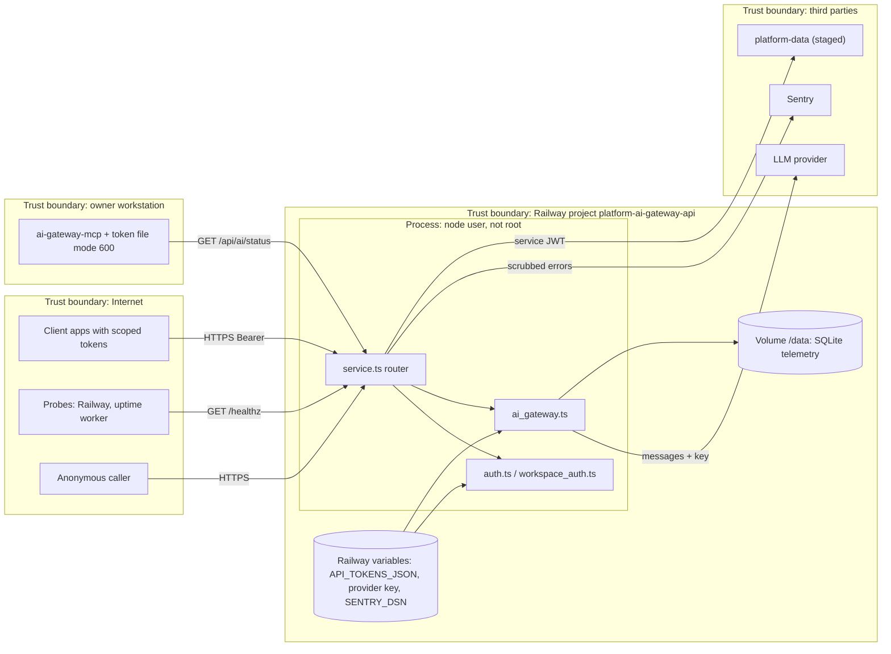

# 13 — Threat model (DFD + STRIDE)

## STRIDE

| Element | Threat | Existing mitigation (code) | Gap |
|---|---|---|---|
| Client → service | **S** spoofing a client | SHA-256 hash + `timingSafeEqual`, expiry, scope (`api/auth.ts`); workspace JWT RS256 strict claims (`workspace_auth.ts`) | static tokens ไม่มี rotation อัตโนมัติ |
| Client → service | **T** tamper workspace authority | header `x-workspace-id` ฯลฯ และ body `ws/workspace/tenant_id` ถูกปฏิเสธ 400 (`service.ts`) | — |
| service | **R** repudiation | structured log `ai_gateway.run` ต่อ request พร้อม `subject`, `run_id`; telemetry row มี `subject` ใน `metadata_json` | log อยู่ใน Railway เท่านั้น ไม่มี retention ที่กำหนด |
| service → provider | **I** prompt/data leak | privacy_class private/restricted → 403; ไม่ persist prompt/output; error ไม่ส่ง provider body; Sentry `sendDefaultPii: false`, scrub URL/token/JWT | public/internal ยังส่งถึง third-party provider ตามออกแบบ |
| `/api/ai/status` | **I** config leak | เปิดแค่ boolean `api_key_configured`, ชื่อ model ที่ผ่าน `safeName` | — |
| service | **D** cost / DoS | rate limit ต่อ subject + concurrency global 8 (default), body ≤ 1 MiB, `headersTimeout` 15 s, provider timeout 30 s, monthly budget hard stop, fallback ≤ 1 ครั้ง | limiter อยู่ใน process; ไม่มี limit ก่อน auth สำหรับ anonymous (เช่น ต่อ IP) |
| service | **E** privilege | refuse `API_TOKEN`/`ALLOW_UNAUTH_DEV` ตอน start; process รันเป็น `node` ผ่าน `setpriv` | — (`*` ตั้งค่าไม่ได้: `SCOPE_PATTERN` ปฏิเสธตอน parse) |
| Volume `/data` | **T/I** | ไม่มี content ใน DB; `CHECK` constraints | ไม่มี backup (ดู 14) |
| Railway variables | **I** | secret อยู่ใน Railway เท่านั้น (`AGENTS.md`), `gitleaks` ใน CI | — |
| MCP | **S/E** | ไม่มี identity argument, strict input, token file ต้อง mode 600, URL https | — |
| CI supply chain | **T** | reusable workflows pin SHA, `permissions: contents read`, `persist-credentials: false` ใน `shared-runtime.yml`, semgrep/osv/trivy | `shared-runtime.yml` ใช้ `actions/*@v4/v5` แบบ tag ไม่ pin SHA; `main` ไม่มี branch protection |

Sources: `api/auth.ts`, `api/workspace_auth.ts`, `api/ai-gateway-service/service.ts`, `api/ai_gateway.ts`, `api/ai_rate_limit.ts`, `api/ai_budget.ts`, `api/ai-gateway-service/sentry.ts`, `api/ai-gateway-service/entrypoint.sh`, `mcp/ai-gateway-mcp.ts`, `.github/workflows/ci.yml`, `.github/workflows/shared-runtime.yml`, `AGENTS.md`, `gh api repos/bookchaowalit/platform-ai-gateway-api/branches/main/protection` (404 "Branch not protected")

## Open questions

- Railway service มี edge protection หน้า `api.bookchaowalit.com` (เช่น Cloudflare proxy) หรือไม่: ไม่มีข้อมูลใน repo
