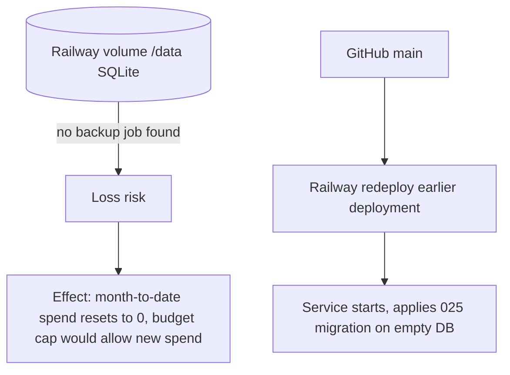

# 14 — Backup / DR

| Data | Where | Backup reality | Restore |
|---|---|---|---|
| `ai_run_telemetry` (spend ledger ของ budget + run metadata) | SQLite `/data/ai-gateway.sqlite` บน Railway volume | **ไม่พบ backup**: repo ไม่มี backup job; platform-db-backup รับเฉพาะ `postgres://` / `mysql://` (README `BACKUP_URL_<NAME>`); ops record: prod-baseline-monitoring-backups ระบุ Neon + Railway DB services (ev3, a2n, tma, scannpop, teeparinwat) ไม่มี ai-gateway | ไม่มี runbook ใน repo; ถ้า volume หาย service จะสร้าง DB ใหม่ว่างตอน start (`mkdirSync` + migration) |
| Config / secrets | Railway variables | ไม่อยู่ใน repo (`AGENTS.md`) | ตั้งใหม่จากแหล่งเจ้าของ |
| Media routing registry | `platform/media-transcription-routing.json` ใน Git | Git | rebuild image |
| Code / image | GitHub + Railway deployments | Git; Railway เก็บ deployment เก่า | redeploy deployment เดิมใน Railway (`README.md` Deploy) |

ผลกระทบสำคัญ: budget guard อ่าน spend จากตารางนี้ (`api/ai_budget.ts` `querySpend`) ถ้าไฟล์หาย cap รายเดือนจะเริ่มนับใหม่

- RTO: not defined
- RPO: not defined

Sources: `api/ai-gateway-service/store.ts`, `api/ai-gateway-service/main.ts`, `api/ai_budget.ts`, `README.md`, `AGENTS.md`, `DOCPACK/00-product-card.md` (§6 "ไม่มี backup ที่ยืนยันได้"), platform-db-backup `README.md` (local copy), ops record: prod-baseline-monitoring-backups (2026-11-03)

## Open questions

- Railway volume backups (ฟีเจอร์ของ provider) เปิดไว้หรือไม่: ไม่มีหลักฐานใน repo
- RTO/RPO ที่ owner ยอมรับได้สำหรับ spend ledger
