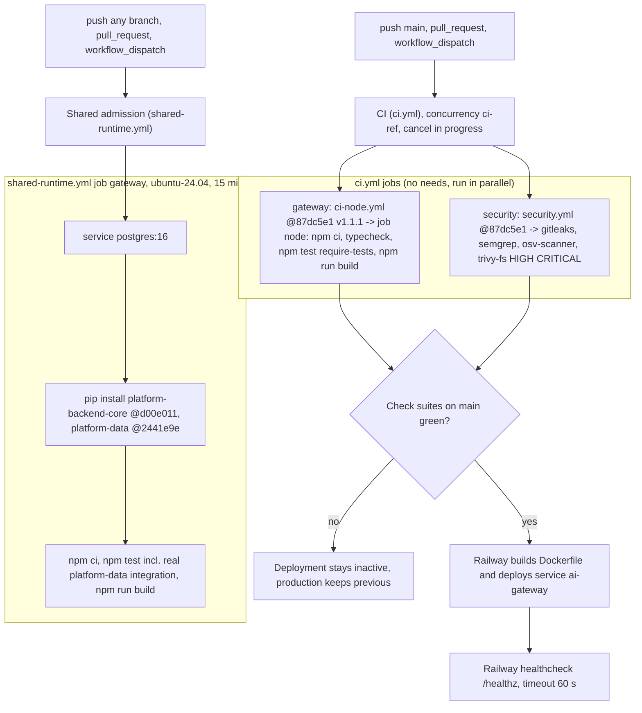

# 15 — CI/CD pipeline

สอง workflow; CD ไม่ได้อยู่ใน GitHub Actions แต่เป็น Railway GitHub source + Wait for CI (`README.md` Deploy)

หลักฐาน gate: deployment `77e8d12` (CI failure: osv-scanner 1 High, trivy-fs) เป็น `in_progress → inactive` ไม่เคย success; PR #7 (`a9843e8`) แก้แล้ว deploy success 2026-10-26 12:05:57Z

Sources: `.github/workflows/ci.yml`, `.github/workflows/shared-runtime.yml`, `.railway/railway.ts`, `Dockerfile`, `README.md`, `gh run list -R bookchaowalit/platform-ai-gateway-api --branch main`, `gh run view` (failed run of `77e8d12`: jobs `security / osv-scanner` and `security / trivy-fs` failure), `gh api repos/bookchaowalit/platform-ai-gateway-api/deployments` + statuses

## Open questions

- Railway Wait for CI รอ check suite ไหนบ้าง (`Shared admission` ด้วยหรือไม่): ตั้งใน Railway ไม่อยู่ใน repo
- `renovate.json` มีอยู่ แต่ไม่พบ PR จาก Renovate ใน `gh pr list`
