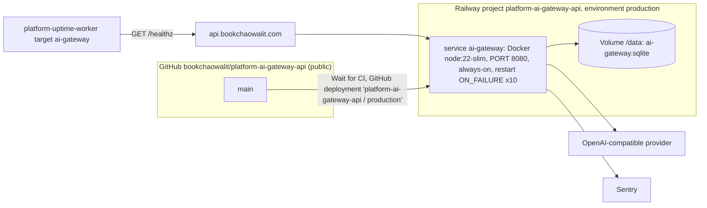

# 16 — Deployment

| Item | Value | Source |
|---|---|---|
| Public URL | `https://api.bookchaowalit.com` | `README.md` |
| Host | Railway project `platform-ai-gateway-api`, service `ai-gateway`, always-on | `README.md`, `PRODUCT.md` |
| Build | Dockerfile 2-stage, esbuild bundle + `dist/migrations/025_ai_run_telemetry.sql` | `Dockerfile`, `.railway/railway.ts` |
| Runtime env defaults | `NODE_ENV=production`, `PORT=8080`, `AI_GATEWAY_DB_PATH=/data/ai-gateway.sqlite` | `Dockerfile` |
| Secrets | Railway variables only | `AGENTS.md`, `README.md` |
| Current prod commit | `a9843e8` (last deployment status `success` 2026-10-30 18:49:47Z); `b8141c9` deployment went `in_progress → inactive` | `gh api …/deployments/{id}/statuses` |
| Release tag in Sentry | `RAILWAY_GIT_COMMIT_SHA` | `api/ai-gateway-service/sentry.ts` |

Sources: `README.md`, `PRODUCT.md`, `Dockerfile`, `.railway/railway.ts`, `AGENTS.md`, `api/ai-gateway-service/sentry.ts`, `platform-uptime-worker/src/targets.ts`, `gh api repos/bookchaowalit/platform-ai-gateway-api/deployments`

## Open questions

- ทำไม deployment ของ `b8141c9` (merge shared admission, 2026-10-28) ไม่ถึง `success` และ `a9843e8` ถูก redeploy 2026-10-30: production จึงยังไม่มี code shared admission (ซึ่งปิดอยู่โดย default อยู่แล้ว)
- region ของ Railway service และ DNS (CNAME/proxy) ของ `api.bookchaowalit.com` ไม่อยู่ใน repo
