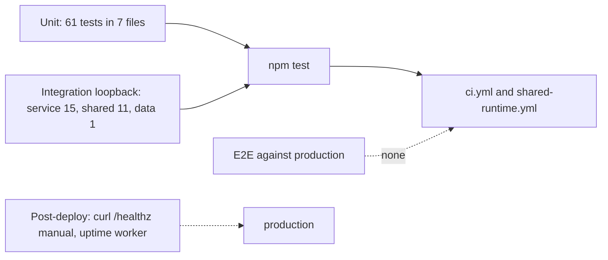

# 17 — Test coverage matrix

runner: `node:test` ผ่าน `tsx --test tests/*.ts` (`package.json`); ไม่มี coverage report (comment ใน `ci.yml`); "integration" = service จริงบน loopback กับ fake provider; "e2e" = ไม่มี test ยิง production

| Feature | Unit | Integration (loopback HTTP) | E2E / prod |
|---|---|---|---|
| Scoped token auth | `tests/auth.test.ts` (6) | `tests/ai_gateway_service.test.ts` (status/generate scope, legacy refused) | gap |
| Generate core, Thai policy, payload options | `tests/ai_gateway.test.ts` (15) | `tests/ai_gateway_service.test.ts` (payload, content-free telemetry, chat order) | gap |
| Fallback | `tests/ai_gateway.test.ts` | `tests/ai_gateway_service.test.ts` (5xx, timeout) | gap |
| Rate limit | `tests/ai_rate_limit.test.ts` (4) | `tests/ai_gateway_service.test.ts` (Retry-After) | gap |
| Budget | `tests/ai_budget.test.ts` (13) | `tests/ai_gateway_service.test.ts` (fail closed, persists across restart) | gap |
| Privacy class | — | `tests/ai_gateway_service.test.ts` (`private` → 403) | gap; `restricted` not asserted |
| Body limits / errors | — | `tests/ai_gateway_service.test.ts` | gap |
| Telemetry store / migration | — | `tests/ai_gateway_service.test.ts` (idempotent migration) | gap |
| Media route | `tests/media_router.test.ts` (8) | `tests/ai_gateway_service.test.ts` (scope + decision) | gap |
| Sentry scrub | `tests/sentry.test.ts` (5) | — | gap |
| MCP server | `tests/ai_gateway_mcp.test.ts` (10, fake fetch) | — | gap |
| Workspace JWT + shared admission | — | `tests/ai_shared_admission_test.ts` (11, two gateways) | gap |
| Real platform-data + PostgreSQL | — | `tests/ai_shared_data_integration_test.ts` (1, opt-in; runs in `shared-runtime.yml`) | gap |
| `/readyz` | — | `tests/ai_shared_admission_test.ts` ("readiness fails closed…") | gap |
| `entrypoint.sh`, Dockerfile | — | gap (build only, no container test) | Railway healthcheck only |

จำนวน test นับจาก `test(` ใน แต่ละไฟล์: auth 6, ai_gateway 15, mcp 10, rate_limit 4, budget 13, media 8, sentry 5 (= 61), service 15, shared admission 11, shared data 1 (รวม 88)

Sources: `tests/*.ts`, `tests/fixtures/shared_data_server.py`, `package.json`, `.github/workflows/ci.yml`, `.github/workflows/shared-runtime.yml`, `specs/001-l2-baseline/spec.md` ("npm test (76 passed)" ณ 2026-10-24 ก่อน shared admission merge)

## Open questions

- ไม่มี coverage gate (ADR-0004 ของ architecture-docs เป็น opt-in) จะเพิ่ม reporter เมื่อไร
