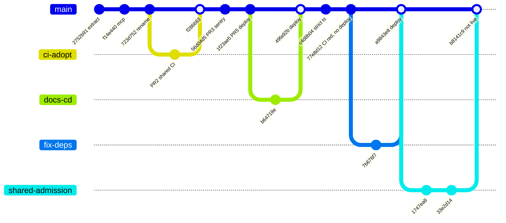
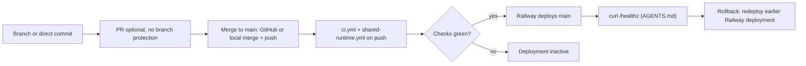

# 18 — Git / release workflow

trunk-based บน `main`: งานส่วนใหญ่มาเป็น PR สั้น ๆ (squash/merge) บางงาน merge ในเครื่องแล้ว push (merge commits `49fa92b`, `a9843e8`, `b8141c9`; PR #1 ถูก close และ merge locally) ไม่มี release tag; release = deployment ของ Railway

Sources: `git log origin/main`, `gh pr list -R bookchaowalit/platform-ai-gateway-api --state all`, `gh api …/deployments`, `gh api …/branches/main/protection` (404), `README.md`, `AGENTS.md`

## Open questions

- จะใช้ release tag / CHANGELOG หรือไม่ (ปัจจุบันไม่มี)
