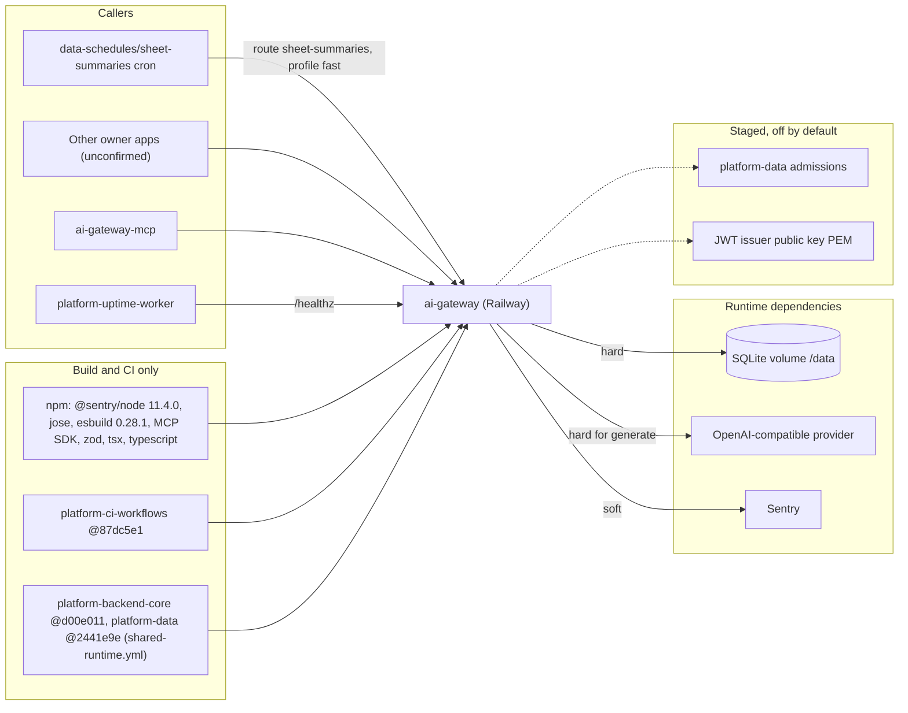

# 19 — Service dependency map

ความรุนแรง: SQLite ใช้ไม่ได้ → `/healthz` 503 และ budget unavailable; provider ล่ม → 502/504 (fallback ถ้าตั้ง); Sentry ล่มไม่กระทบ request; ops record: railway-deploy-approval-gate (2026-11-03): OpenAI key ถูก revoke 2026-10-26 16:11 → 10-27 12:00 UTC ทุก call ตอบ 502 `provider_auth`

Sources: `api/ai-gateway-service/service.ts`, `store.ts`, `sentry.ts`, `api/ai_gateway.ts`, `api/ai_shared_admission.ts`, `api/workspace_auth.ts`, `package.json`, `api/ai-gateway-service/package.json`, `.github/workflows/*.yml`, `mcp/ai-gateway-mcp.ts`, `platform-uptime-worker/src/targets.ts`, ops record: sheet-summaries-cron (2026-11-03), ops record: railway-deploy-approval-gate (2026-11-03)

## Open questions

- รายชื่อ caller ทั้งหมดใน production (ต้องดู subject ใน `API_TOKENS_JSON` หรือ telemetry `metadata_json.subject`)
