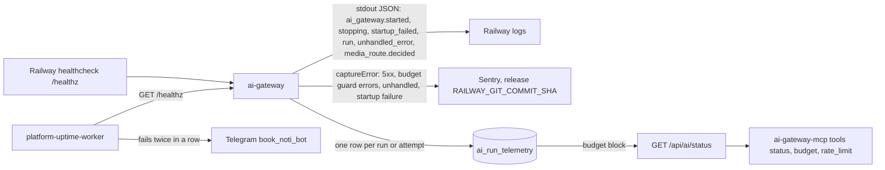

# 20 — Observability

| Signal | What is watched | Source |
|---|---|---|
| `ai_gateway.run` log | subject, route, profile, provider, model, status, error_class, fallback_used, tokens, cost, latency, http_status, code | `service.ts` `logRun` |
| Sentry | errors only; no tracing (no `tracesSampleRate`), `sendDefaultPii: false`, scrubbed events | `sentry.ts`, `tests/sentry.test.ts` |
| Telemetry DB | spend and per-run metrics (PRODUCT.md Measures: success share, spend vs budget, fallback use, p95 latency) | `store.ts`, `PRODUCT.md` |
| Status endpoint | budget decision, rate-limit counters, `telemetry_store` | `service.ts` |
| Uptime | target `ai-gateway` → `https://api.bookchaowalit.com/healthz`, group `own` | `platform-uptime-worker/src/targets.ts`, ops record: prod-baseline-monitoring-backups (2026-11-03) |

ไม่พบ: dashboard, alert บน budget/429/502 rate, หรือ metric exporter

Sources: `api/ai-gateway-service/main.ts`, `service.ts`, `sentry.ts`, `store.ts`, `mcp/ai-gateway-mcp.ts`, `railway.json`, `PRODUCT.md`, `platform-uptime-worker/src/targets.ts`, `platform-uptime-worker/README.md`

## Open questions

- ไม่มี alert เมื่อ `provider_auth` 502 ต่อเนื่อง (เหตุ 2026-10-26: `/healthz` ยัง 200 ระหว่าง provider key ใช้ไม่ได้ เพราะ healthz เช็คแค่ SQLite) — ใครดู Sentry
- PRODUCT.md Measures (p95 latency, fallback share) คำนวณที่ไหน: ไม่พบ query/dashboard
