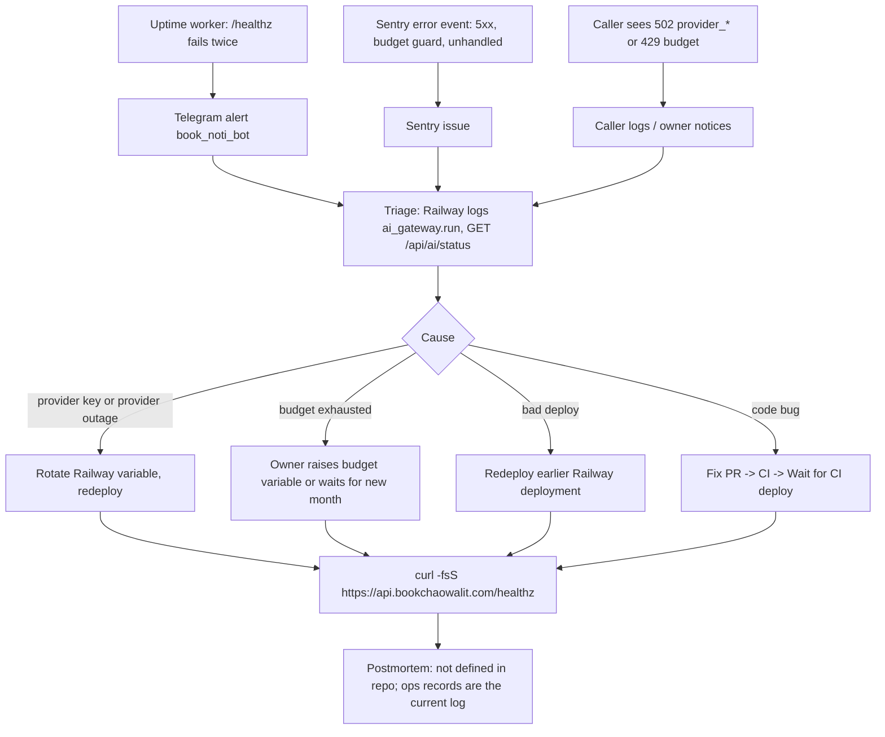

# 21 — Incident response

ไม่มี runbook ใน repo นี้; `README.md` ชี้ไป solo-empire `operations/runbooks/AI-API-GATEWAY-RUNBOOK.md` (ไม่ได้อ่านใน pack นี้) flow ด้านล่างประกอบจาก channel ที่มีจริง

ตัวอย่างจริง: ops record: railway-deploy-approval-gate (2026-11-03) — OpenAI key revoked 2026-10-26 16:11 → 10-27 12:00 UTC, ทุก call 502 `provider_auth` (~19 h 49 m); ops record: sheet-summaries-cron (2026-11-03) — deploys skipped ขณะ security CI แดง แก้ด้วย PR #7

Sources: `README.md` (Runbook, Deploy), `AGENTS.md`, `api/ai-gateway-service/service.ts`, `api/ai-gateway-service/sentry.ts`, `platform-uptime-worker/README.md`, ops record: railway-deploy-approval-gate (2026-11-03), ops record: sheet-summaries-cron (2026-11-03)

## Open questions

- Sentry alert rule ของ project นี้ส่งไปที่ไหน
- เนื้อหา `AI-API-GATEWAY-RUNBOOK.md` ใน solo-empire ยังตรงกับ CD ปัจจุบันหรือไม่
- ไม่มี postmortem template/ที่เก็บ
