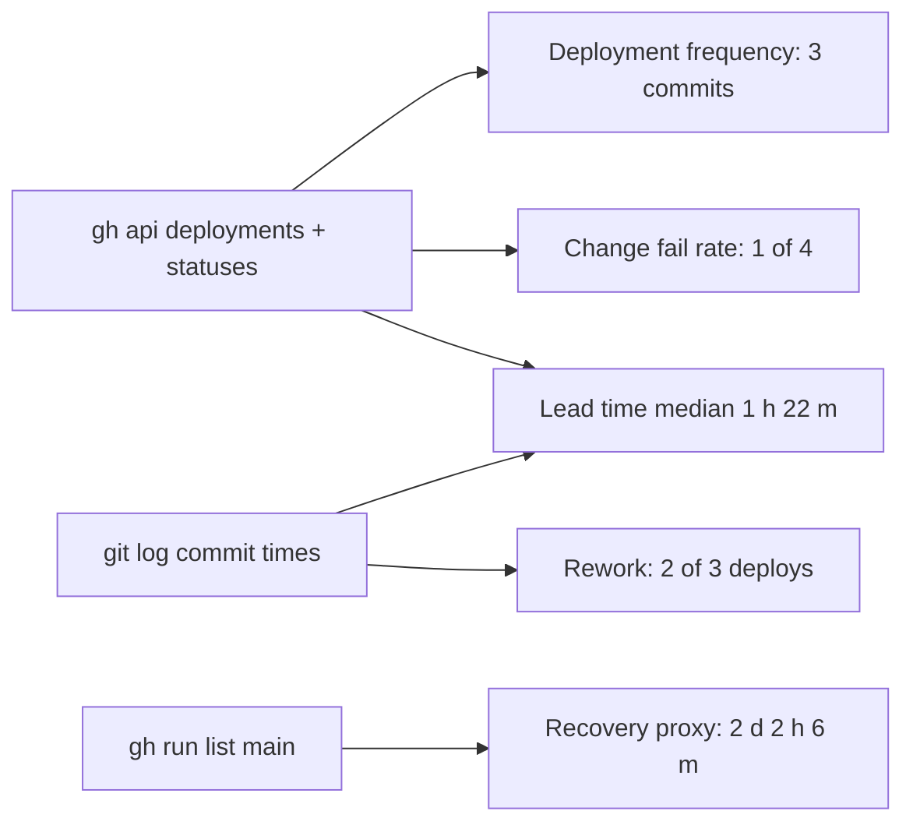

# 22 — DORA metrics

หน้าต่าง: 90 วันถึง 2026-11-03 (repo เริ่ม 2026-10-10 จึงครอบทั้งประวัติ) แหล่ง deploy จริงคือ GitHub deployments ที่ Railway สร้าง (environment `platform-ai-gateway-api / production`) ซึ่งเริ่มมีตั้งแต่ CD 2026-10-18; deploy ก่อนหน้านั้นใช้ `railway up` และไม่มีบันทึกใน repo/GitHub

ตัวแปรในคำสั่ง: `R=bookchaowalit/platform-ai-gateway-api`

| Metric | How measured for this repo | Current value | Command | Confidence |
|---|---|---|---|---|
| Deployment frequency | distinct commits ที่มี deployment status `success` | **3 commits** (`1f23ae5`, `49fa92b`, `a9843e8`) ใน 16 วันตั้งแต่ CD (≈ 1.3 / week); 7 success events รวม redeploy | `for id in $(gh api "repos/$R/deployments?per_page=100" --jq '.[].id'); do sha=$(gh api repos/$R/deployments/$id --jq '.sha[0:7]'); gh api repos/$R/deployments/$id/statuses --jq ".[]\|select(.state==\"success\")\|\"$sha \"+.created_at"; done \| sort -k2` | high for since-CD; pre-CD unknown |
| Lead time for changes | first commit ของ change → first deployment `success` | `49fa92b` 6 m 35 s; `a9843e8` 1 h 22 m 14 s; `1f23ae5` 2 h 41 m 28 s (บิดเพราะ deployment record แรกถูกสร้างตอนเชื่อม CD 11:14Z) → **median 1 h 22 m** (n = 3) | `git log -1 --format=%cI <sha>` สำหรับ `b64719e`, `7b676f7`, `1f23ae5` เทียบกับเวลาในคำสั่งแถวบน | low: n = 3 |
| Change fail rate | deployment ที่ผ่าน CI แต่ไม่ถึง `success` หรือทำให้ prod เสีย | **1 / 4 = 25 %** (`b8141c9` in_progress 2026-10-28 → inactive 2026-10-29, ไม่เคย success); ไม่มี deploy ใดผูกกับ prod incident ที่บันทึกไว้ | `gh api repos/$R/deployments/7392772778/statuses --jq '.[]\|.state+" "+.created_at'` | medium |
| Failed deployment recovery time | เวลาจาก deploy ล้ม → prod กลับสู่ปกติ | **cannot compute**: `b8141c9` ไม่ได้ทำให้ prod ล่ม (prod อยู่ที่ `a9843e8` ต่อ) Proxy CI: main แดง `77e8d12` 2026-10-24T09:59:15Z → main เขียว `a9843e8` 2026-10-26T12:05:06Z = **2 d 2 h 6 m** | `gh run list -R $R --branch main --event push -L 100 --json createdAt,conclusion,headSha,workflowName` | proxy only |
| Deployment rework rate | deployments ที่เป็น fix ของงานก่อนหน้า / ทั้งหมด | **2 / 3 = 67 %** (`1f23ae5` fix(sentry), `a9843e8` merge fix(deps)); commit proxy **4 / 20 = 20 %** non-merge commits ขึ้นต้น `fix` | `git log --since=90.days --no-merges --format=%s origin/main \| grep -ciE '^(fix\|revert)'` ; `git log --since=90.days --no-merges --oneline origin/main \| wc -l` | low: n = 3 |

ข้อสังเกต: `c4d8b04` (2026-10-22) CI เขียวแต่ไม่มี deployment record และ `77e8d12` CI แดงจึงไม่ deploy (gate ทำงาน); ทั้งสองเข้าสู่ prod ผ่าน `a9843e8`

Sources: `gh api repos/bookchaowalit/platform-ai-gateway-api/deployments` (5 records) + `/statuses`, `gh run list` (10 runs on main), `gh pr list --state merged`, `git log origin/main` at `b8141c9`, `README.md` (CD since 2026-10-18)

## Open questions

- ทำไม deployment ของ `b8141c9` ไม่ถึง `success` (ดูใน Railway deployment history ได้เท่านั้น) และใครสั่ง redeploy `a9843e8` 2026-10-30
- ไม่มี incident log ที่ผูกกับ deployment จึงวัด change fail rate / recovery แท้ไม่ได้
