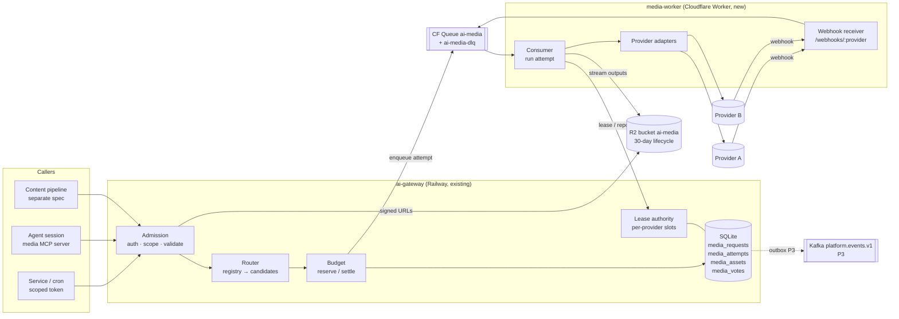

# SPEC-003 — Multi-provider image and video generation pipeline

Standard: ADR-0004 — TDD + SDD (architecture-docs, `docs/architecture/decisions/ADR-0004-tdd-sdd-standard.md`).

## Document control

| Field | Value |
|---|---|
| Spec ID / version | SPEC-003 / 1.0 |
| Status | approved 2026-11-11 (owner); P1a code complete on branch `spec/003-media-generation` (not pushed, not deployed); Q1–Q4 open, Q5 = option A |
| Repository / path | bookchaowalit/platform-ai-gateway-api / `specs/003-media-generation/spec.md` |
| Owner (maker) | Claude Code |
| Reviewer (checker) | Fresh Claude reviewer session (no maker context), plus Codex review at Stop |
| Approver | Owner (bookchaowalit) |
| Requirement links | Owner 2026-11-11: "do we have an AI pipeline that generates images and videos?" (no) → "draft the spec" → "use several models and compare them; lay out the pipeline flow in detail so it is flexible and can scale" |
| Related docs | `specs/002-tools-vision/spec.md` (subjects, budgets, privacy rules, image validation reused here); `platform/media-transcription-routing.json` + `api/media_router.ts` (the data-driven ranking pattern copied here); ADR-0008 messaging (Cloudflare Queues, Kafka event plane); ADR-0013 data tiers (one R2 lake) |
| Main-only | no: branch `spec/003-media-generation`, merged locally after review |
| Created / approved | 2026-11-11 / 2026-11-11 (owner) |

## 1. Problem and intent

- **Problem:** nothing in the platform generates images or video. The gateway reads images (SPEC-002) but cannot make
  them. Every image or video model is good at different things (photo realism, text inside the image, vector/design,
  short social clips, camera motion), prices differ by 10× or more, and rankings change every few months. Wiring one
  provider into each consumer would fix today's choice into code, put keys in many places, and leave no way to compare
  models on our own prompts. Video also takes minutes per clip, which the synchronous gateway cannot hold.
- **Outcome:**
  1. One API for every image and video model: a caller asks by **profile** ("social-square-photo",
     "thai-text-poster", "short-vertical-clip") or by explicit model id, and the gateway picks the model from a
     versioned registry. Changing the best model is a data edit, not a code change.
  2. **Compare mode:** the same brief goes to 2–4 models in one request; the results come back as one set that a person
     (or an automatic judge) scores. Scores feed the registry ranking.
  3. **Scales by queue:** the gateway only admits, prices and records; the provider work runs in a queue-driven
     worker, so more volume is more worker concurrency, not a bigger gateway.
  4. Every call is reserved against the subject's budget before any provider is called, recorded without prompt text,
     and stored in R2 behind short-lived signed URLs. Everything is off until configured; existing callers see no change.
- **Why now:** content work (pSEO hub, portfolio, X posts, offers) keeps asking for visuals, and the owner wants the
  choice of model to be measured, not guessed.

## 2. Scope and phases

| Phase | In scope | Exit criterion |
|---|---|---|
| **P1a — image core, one path** | Registry + router; adapter interface; 1 image provider (OpenAI, key already held); `single` mode on `POST /api/ai/media/requests` + GET; queue + media worker; lease authority; encrypted payload; SQLite reservations and settlement (§4.7); R2 storage; status + models catalog | Live smoke: one image, cost row matches the price table, restart mid-job recovers |
| **P1b — compare** | Second image provider (§7 Q1); `compare` mode, votes, `blind`; fallback; `POST /api/ai/images` with `wait_ms`; MCP media server | Live smoke: one compare set of 2 models × 1 image, voted |
| **P2 — video + references** | Video adapters (2 providers); async polling by delayed re-queue and provider webhooks; reference inputs (image-to-image, image-to-video) from uploaded or earlier assets; cancel | Live smoke: one 2-model video compare set completed through a webhook and one through polling |
| **P3 — pipeline + learning loop** | Automatic judge (vision model through `/api/ai/generate`); variants (resize, WebP, poster frame); media events to Kafka → lake Bronze; weekly ranking report proposing registry edits | First weekly report generated from real votes |

| Out of scope (all phases) | Why |
|---|---|
| The content pipeline that turns a brief or calendar into posts and publishes them | Separate consumer spec; it calls this API (§3.2 shows where it plugs in) |
| Fetching remote URLs as inputs | SSRF; inputs are uploaded through the gateway |
| `private` / `restricted` prompts or references | Media prompts and references go to third-party providers; revisit with a per-provider attestation like SPEC-002 AC-07 |
| Training or fine-tuning models (LoRA, custom styles) | Later; the registry can name a fine-tuned model id once one exists |
| Public CDN hosting | Consumers copy what they keep into their own storage |
| Billing clients for media | The usage report per subject is the input for that |

## 3. Architecture and flow

### 3.1 Components



- **Gateway** stays the single writer of job state and money: it validates, routes, reserves budget, writes the rows,
  enqueues one message per attempt, and later settles cost from the worker's report. It never calls a media provider
  itself and never handles media bytes: outputs go worker → R2, and reference uploads (P2) go caller → R2 through a
  presigned PUT, with the gateway only signing URLs and reading the first bytes at finalize.
- **media-worker** (new, Cloudflare Worker in this repository under `workers/media-worker/`, deployed with Wrangler)
  consumes `ai-media`, calls the provider through an adapter, streams outputs to R2 through its bucket binding, and
  reports back to the gateway's internal endpoints with a dedicated token (scope `ai:media-worker`). Scaling is the
  queue's consumer concurrency.
- **Lease authority:** before a provider call the worker asks the gateway for a slot (`max_concurrent` and `rpm` per
  provider in the registry). No slot → the message is retried with a delay. This keeps provider rate limits correct
  however many worker instances run.
- **Registry** `platform/media-generation-routing.json`: providers, models, capabilities, normalised parameter maps,
  prices, limits, profiles and our own eval scores (§4.3).

### 3.2 End-to-end pipeline (target; P1a delivers stages 3–4, P1b adds 6, P2 adds references, P3 adds 5 and 7–8)

| # | Stage | Who | Input → output | Notes |
|---|---|---|---|---|
| 1 | Brief | consumer | goal, audience, channel, brand profile → brief | Content pipeline spec |
| 2 | Prompt build | consumer via `/api/ai/generate` (json_schema) | brief → `{prompt, negative_prompt?, aspect, profile}` | Uses SPEC-002 structured output; prompt templates versioned in the consumer |
| 3 | Route | gateway | profile / model ids + constraints → ranked candidate list | §3.4 |
| 4 | Generate | worker | attempt → outputs in R2 | One attempt per model; fallback to the next candidate on provider failure |
| 5 | Auto-check | worker → gateway `/api/ai/generate` with image input (P3) | output → `{adherence, text_ok, artifacts, safety}` scores | Judge model and rubric versioned; scores stored as votes with `source: judge`, `judge_id: <rubric_version>` |
| 6 | Human review | caller (MCP, Telegram, gallery) | compare set → vote (winner, 1–5 score, reason tags) | `POST /api/ai/media/requests/:id/votes` |
| 7 | Post-process | worker (P3) | approved asset → variants (sizes, WebP, poster frame) | Variants are new `media_assets` rows pointing at the parent |
| 8 | Learn | weekly job (P3) | votes + cost + latency → ranking report → registry PR | A person merges the PR; nothing re-ranks by itself |
| 9 | Publish | consumer | approved asset URL → consumer storage / page / post | Consumer keeps `ai_generated` and adds alt text |

### 3.3 Request life cycle (video, compare of two models)

```mermaid
sequenceDiagram
  autonumber
  participant C as Caller
  participant G as Gateway
  participant Q as Queue ai-media
  participant W as media-worker
  participant P as Provider
  participant S as R2
  C->>G: POST /api/ai/media/requests {kind: video, mode: compare, profile, n_models: 2}
  G->>G: auth, validate, route → [model A, model B]
  G->>G: reserve price(A)+price(B); write request + 2 attempts (queued)
  G->>Q: 2 messages {attempt_id}
  G-->>C: 202 {id, status: queued, attempts: 2, poll_after_ms}
  Q->>W: attempt A
  W->>G: POST /internal/media/attempts/A/lease
  G-->>W: 200 lease (slot taken)
  W->>P: submit job (webhook URL carries attempt_id + HMAC, when supported)
  W->>G: report submitted {provider_job_ref}
  W->>Q: re-enqueue A with delay (poll) — or wait for webhook
  P-->>W: webhook (signed) → verify → enqueue A
  Q->>W: attempt A (poll / webhook)
  W->>P: fetch status → completed → stream content
  W->>S: put videos/…/A.mp4
  W->>G: report completed {bytes, seconds, provider_cost?}
  G->>G: settle cost, request status = partial / completed (slot was released at submitted, §4.7 rule 5)
  C->>G: GET /api/ai/media/requests/:id
  G-->>C: 200 {status, attempts:[{model, status, assets:[{url, expires_at}]}]}
  C->>G: POST /api/ai/media/requests/:id/votes {winner: A, scores}
```

### 3.4 Routing

1. **Candidates:** the caller gives `models: [...]` (explicit ids from the catalog) or `profile` (+ `n_models` for
   compare). A profile lists ranked model ids per kind.
2. **Filter** each candidate, in this order, and record the first reason a model drops out (returned in
   `routing.skipped` without values): capability (kind, aspect, resolution, duration, reference input, audio) →
   privacy class allowed for that provider → credential present → model `enabled` →
   price known for the requested parameters → per-subject allow-list (optional `AI_GATEWAY_MEDIA_SUBJECT_MODELS_JSON`) →
   budget left for this model's price.
3. **Order:** profile order, unless `own_eval` scores newer than `max_evaluation_age_days` exist for that profile, then
   by score descending with profile order as the tie-break (same rule as the transcription router).
4. **Pick:** `single` takes the first model and keeps the next `fallback_depth` (default 1) as fallbacks; `compare`
   takes the first `n_models` distinct providers when possible (so a compare set is not two models of one vendor
   unless the caller lists them).
5. **Fallback:** a retryable provider failure (429 after retries, 5xx, timeout; recorded as `provider_error` or `timeout`) on a `single`
   request creates a new attempt on the next model; its price is reserved before it is enqueued. A content-policy
   rejection is not retried on another model (no policy shopping).

### 3.5 Attempt state machine

```mermaid
stateDiagram-v2
  [*] --> queued
  queued --> leased: start lease granted (slot taken)
  queued --> queued: no slot / gateway down (ack + re-send with delay)
  leased --> queued: lease expired before submit_started (lease_recoveries + 1)
  submit_started --> submit_started: lease expired, re-leased; rule 4 decides re-submit or submit_unknown
  leased --> submit_started: worker reported intent (before the paid call)
  submit_started --> submitted: provider accepted (async), slot released
  submit_started --> completed: provider returned outputs, stored in R2 (sync)
  submit_started --> failed: provider error / policy / submit_unknown
  submitted --> submitted: poll or webhook, not done (short lease, poll_count + 1)
  submitted --> completed: outputs stored in R2
  submitted --> failed: provider error / policy / timeout
  leased --> failed: lease_exhausted / payload_unavailable
  queued --> failed: dispatch_error / timeout
  queued --> cancelled: caller cancel (P2)
  leased --> cancelled: caller cancel before submit_started (P2)
  submitted --> cancelled: caller cancel, provider cancel sent (P2)
  completed --> expired: R2 object gone (lifecycle)
  failed --> [*]
  cancelled --> [*]
  expired --> [*]
```

A request's status is derived from its attempts: `queued` (none started), `running`, `partial` (some completed, others
running), `completed` (all terminal and ≥ 1 completed), `failed` (all terminal, none completed), `cancelled`.

## 4. Interfaces and data

### 4.1 HTTP API (gateway)

| Route | Scope | Phase | Contract |
|---|---|---|---|
| `POST /api/ai/media/requests` | `ai:image` or `ai:video` (by `kind`) | P1a (compare/blind P1b, video P2) | Body `{kind, mode: single\|compare, blind?: boolean (compare only, default false), profile?, models?, n_models?, prompt, negative_prompt?, aspect, resolution?, n?, seconds?, audio?, format?, references?, params?, route, privacy_class, purpose?, dry_run?: boolean, expected_reserved_usd?: number}` (`dry_run` validates, routes and prices but reserves and enqueues nothing: 200 with `routing` and `reserved_usd`); optional `Idempotency-Key`; 202 `{id, status, attempts, poll_after_ms, routing:{selected, skipped}, reserved_usd}` |
| `GET /api/ai/media/requests/:id` | same as create | P1a | Query `voter_label?` (decides whether a blind set is revealed to this caller). 200 `{id, kind, mode, status, created_at, attempts:[{id, model, provider, status, error?, latency_ms?, cost_usd, assets:[{id, url, expires_at, media_type, width?, height?, seconds?, bytes}]}], votes_summary}`; another subject's id → 404 |
| `POST /api/ai/media/requests/:id/votes` | same as create | P1b | `{winner_attempt_id?, scores?:{<attempt_id>: 1-5}, tags?: [..], note?, voter_label?}` with at least one of `winner_attempt_id` / `scores`; `voter_label` (≤ 40 chars, `[a-z0-9-]`, no personal data) lets several people share one service token; unique key per §4.4 `media_votes` where `source` is `api`, `mcp` or `judge`; a later vote replaces the earlier one; votes are accepted after assets expire |
| `POST /api/ai/media/requests/:id/cancel` | same as create | P2 | 202. `queued` attempts (and `leased` ones before `submit_started`) are closed `cancelled` at once, and their next lease or `submit_started` report gets 409 `cancelled` so no provider call starts; `submit_started`/`submitted` attempts get `cancel_requested_at` set and a signed `cancel` message is enqueued; the worker leases it, calls the adapter's `cancel` (where supported) and reports `cancelled`; the attempt is closed only on that report (or at the attempt TTL); settlement follows AC-06 |
| `POST /api/ai/images` | `ai:image` | P1b | Sugar for `kind:image, mode:single` with `wait_ms` (default 60,000, max 120,000): 200 with the request body when done in time, else 202 like the create route |
| `POST /api/ai/media/assets` · `POST /api/ai/media/assets/:id/finalize` | `ai:image` or `ai:video` | P2 | Two-step upload so bytes never pass through the gateway (its body cap is 1–4 MiB): create takes `{media_type, bytes}` (png/jpeg/webp, `bytes` ≤ `AI_GATEWAY_MEDIA_MAX_REFERENCE_BYTES`, default 10 MB) and returns `{asset_id, upload_url, expires_at}`, a presigned R2 PUT for one key signed with exactly that `Content-Type` and `Content-Length`, TTL 10 min; finalize does a HEAD (size must equal `bytes`), reads the first bytes to check magic bytes, then server-side copies the object to a final key under `refs/` that no presigned PUT is ever issued for, with copy-source `If-Match` = the ETag from the HEAD, re-checks magic bytes on the final object (deleting it on failure), deletes the staging key and records `sha256` + the final `etag`; references are read by ETag (`If-Match`), so the bytes a request uses cannot change after finalize, and marks the asset usable; an asset never finalized is deleted by the lifecycle and cannot be referenced |
| `GET /api/ai/media/models` | `api:read` | P1a | Catalog from the registry: enabled models with capabilities, normalised parameters, unit prices and availability for this caller; no credential names |
| `GET /api/ai/status` | `api:read` | P1a | Adds `capabilities.media: {image, video, compare, references}` and media limits |
| `POST /internal/media/attempts/:id/lease` · `/report` · `/heartbeat` | `ai:media-worker` | P1a | Worker-only; lease takes `{reason, dispatch_no, sig}` and returns 200 `{lease_id, lease_deadline, attempt: {state, model_id, provider_id, provider_model, mapped_params, n, seconds, media_type, max_output_bytes, object_key_prefix, provider_job_ref?, idempotency_key: attempt_id, reference_object_keys?}, payload?}` — `payload` (decrypted prompt, negative prompt) whenever the next step calls the provider to submit (`start`, or a re-lease in `submit_started`); `provider_job_ref` only to this worker route, for poll/webhook/cancel; 409 `no_slot` with `retry_after_ms`, or 403 on a bad signature; report takes `{lease_id, report_seq, state, …}` and follows §4.7 rules 3–5; `heartbeat` extends a lease (rule 5) |

- `params` passes model-specific options, but only keys the registry lists in that model's `extra_params` allow-list,
  with their types and ranges; anything else is a 400. Unknown top-level fields are a 400.
- Normalised parameters: `aspect` (`1:1`, `4:5`, `3:2`, `16:9`, `9:16`), `resolution` (`draft`, `standard`, `high`),
  `seconds`, `format`. Each model's registry entry maps these onto its own fields (for example a pixel size), so callers
  never send provider-specific sizes.

### 4.2 Provider adapter interface (`api/media/adapter.ts`, used by the worker)

```ts
interface MediaAdapter {
  id: string;                                   // registry provider id
  submit(job: NormalisedJob, ctx: AdapterCtx): Promise<
    | { kind: 'sync'; outputs: OutputRef[]; providerCostUsd?: number }
    | { kind: 'async'; providerJobRef: string; pollAfterMs: number; webhook: boolean }>;
  poll(ref: string, ctx: AdapterCtx): Promise<
    | { state: 'running'; progress?: number; pollAfterMs: number }
    | { state: 'completed'; outputs: OutputRef[]; providerCostUsd?: number }
    | { state: 'failed'; code: 'content_policy' | 'provider_error' | 'invalid_input' }>;
  cancel?(ref: string, ctx: AdapterCtx): Promise<void>;
  verifyWebhook?(req: Request, ctx: AdapterCtx): Promise<{ providerJobRef: string } | null>;
}
// OutputRef is either inline bytes (base64 decoded by the adapter) or a provider URL the worker streams from once.
```

- A new provider is: one adapter file + registry entries + one recorded-fixture contract test. No gateway change.
- Aggregators (one key, many models) are just adapters whose registry entries carry many models.
- Provider URLs are fetched only from hosts in that provider's registry `output_hosts` allow-list, once, by the worker.

### 4.3 Registry `platform/media-generation-routing.json` (schema `solo-empire.media-generation-routing.v1`)

```jsonc
{
  "schema_version": "solo-empire.media-generation-routing.v1",
  "updated_at": "2026-11-11",
  "policy": { "max_evaluation_age_days": 60, "external_privacy_classes": ["public", "internal"], "fallback_depth": 1,
              "lease_wait_max_ms": 1800000, "job_timeout_ms": 1800000 },
  "providers": {
    "<provider-id>": {
      "adapter": "<adapter-id>", "credential_env": "<VAR_NAME>",
      "max_concurrent": 4, "max_in_flight": 20, "rpm": 30, "webhook": true,
      "output_hosts": ["<host>"], "privacy_classes": ["public", "internal"],
      "terms_checked_at": "YYYY-MM-DD"            // retention / training terms read by the owner
    }
  },
  "models": {
    "<model-id>": {
      "provider": "<provider-id>", "provider_model": "<vendor model name>", "kind": "image|video",
      "enabled": false,
      "capabilities": { "aspects": ["1:1"], "resolutions": ["standard"], "seconds": [5], "audio": false,
                        "references": 0, "text_in_image": "good|fair|poor", "max_n": 4 },
      "param_map": { "aspect": { "1:1": { "size": "1024x1024" } }, "resolution": { "standard": { "quality": "medium" } } },
      "extra_params": { "seed": { "type": "integer", "min": 0, "max": 4294967295 } },
      "pricing": { "unit": "image|second", "cost_source": "registry|provider", "cancel_policy": "free|charged", "usd": { "1:1|standard": 0.0 }, "source": "<url>", "checked_at": "YYYY-MM-DD" },
      "own_eval": null
    }
  },
  "profiles": {
    "social-square-photo": { "kind": "image", "defaults": { "aspect": "1:1", "resolution": "standard" }, "models": ["<model-id>", "<model-id>"] },
    "thai-text-poster":    { "kind": "image", "defaults": { "aspect": "4:5" }, "requires": { "text_in_image": "good" }, "models": [] },
    "short-vertical-clip": { "kind": "video", "defaults": { "aspect": "9:16", "seconds": 5 }, "models": [] }
  }
}
```

- `own_eval` per model and profile: `{evaluated_at, votes, win_rate, mean_score, judge_score?, p50_latency_ms, cost_per_accepted_usd}`,
  written by the P3 report into a PR, never by the running service.
- Prices are copied from the provider's pricing page with `source` and `checked_at`; a model whose `checked_at` is
  older than 90 days is reported on `/api/ai/status` (still usable).
- The registry is bundled at build time (like the transcription registry); a change deploys through CI.

### 4.4 Data (gateway SQLite, new migration file, `CREATE TABLE/INDEX IF NOT EXISTS` only)

`store.ts` today opens one migration file and runs it on every start. This spec changes it to run an ordered list of
migration files (the Dockerfile copies all of `database/migrations/`), each idempotent, with a test that starts twice
on the same database file. No `ALTER TABLE` is used.


| Table | Key columns | Notes |
|---|---|---|
| `media_requests` | `id`, `subject_key`, `kind`, `mode`, `blind`, `profile`, `route`, `status`, `reserved_usd`, `settled_usd`, `prompt_sha256`, `request_hash` (SHA-256 of the canonical body, for idempotency conflicts), `idempotency_key`, `created_at`, `updated_at` | No prompt text; `blind` is fixed at create and read on every GET |
| `media_request_payloads` | `request_id` (PK), `ciphertext`, `nonce` (unique), `key_id`, `created_at`, `purge_after` | The only place the job content lives: `{prompt, negative_prompt, normalised params, params, reference asset ids}` (asset ids only, never bytes) as AES-256-GCM ciphertext with a random 96-bit nonce per row, associated data = `request_id`. Keys come from `AI_GATEWAY_MEDIA_PAYLOAD_KEYS_JSON = {"current": "<key_id>", "keys": {"<key_id>": "<base64 32 bytes>", …}}`: new rows use `current`, older ids stay readable until removed from the env (keep a retired key ≥ 7 days); an unknown `key_id` fails closed with `payload_unavailable`. Read only by `/internal/media/attempts/:id/lease` for a holder of a valid lease; never by public routes, telemetry, events or logs. Purged when every attempt is terminal and no fallback can follow (+ 1 h), and in any case after 7 days; a purged payload makes later leases fail `payload_expired` |
| `media_attempts` | `id`, `request_id`, `model_id`, `provider_id`, `status`, `dispatch_state` (`pending`, `sent`), `dispatch_tries`, `dispatch_no` (random 64-bit, set at create, signed into every message for this attempt), `next_dispatch_at`, `first_leased_at`, `lease_recoveries`, `poll_count`, `submit_started_at`, `overspend_usd`, `flags` (`late_report`, `overspend`, `submit_unknown`), `cancel_requested_at`, `provider_job_ref`, `lease_id`, `lease_deadline`, `report_seq`, `reserved_usd`, `cost_usd`, `error_code`, `latency_ms`, `attempt_no`, timestamps | `provider_job_ref` never returned to callers |
| `media_assets` | `id`, `subject_key`, `attempt_id?` (null for references), `parent_asset_id?`, `role` (`output`, `reference`, `variant`), `state` (`pending_upload`, `ready`, `expired`), `upload_expires_at?`, `staging_key?` (until finalize), `etag?`, `object_key`, `media_type`, `bytes`, `width`, `height`, `seconds`, `sha256`, `created_at`, `expired_at?` | Signed URL made per read |
| `media_votes` | `request_id`, `subject`, `voter_label` (`NOT NULL DEFAULT ''`), `source` (`api`, `mcp`, `judge`), `judge_id` (`NOT NULL DEFAULT ''`), `judge_attempt_id` (`NOT NULL DEFAULT ''`), `winner_attempt_id`, `scores_json`, `tags_json`, `created_at` | Unique `(request_id, subject, voter_label, source, judge_attempt_id, judge_id)`: human votes leave the two judge columns empty (one vote per voter per request), judge votes fill them (one per attempt per rubric); `note` capped at 500 chars and never sent to telemetry |
| `media_provider_slots` | `provider_id`, `lease_id`, `deadline` | Expired leases reclaimed on every lease call |

- `error_code` is one closed set: `content_policy`, `provider_error`, `invalid_input`, `invalid_response`, `budget_exceeded`, `timeout`, `submit_unknown`, `lease_exhausted`, `dispatch_error`, `payload_unavailable`, `cancelled`.
- Indexes: `(subject_key, status)`, **unique** `(subject_key, idempotency_key) WHERE idempotency_key IS NOT NULL` (so two concurrent creates with one key cannot both insert; the loser reads the winner's row); housekeeping sets `idempotency_key` to NULL on requests older than 24 h, so after the window the key frees and a reuse creates a new request, `(status, next_dispatch_at)` on attempts, `(status, updated_at)` on attempts, `(provider_id)` on slots.
- Pruning: request/attempt/vote rows kept 400 days (enough for yearly comparisons; they hold no content); asset rows
  marked `expired_at` once R2 no longer has the object.
- Escape hatch for scale: if writes pass ~20/s sustained or the volume passes 1 GB, move these tables to their own
  Neon project (Neon quota is per project) behind the same store interface; out of scope until then.

### 4.5 Queue messages and storage

- Queue `ai-media` (+ `ai-media-dlq`, max retries 8), message `{v: 1, attempt_id, dispatch_no, reason: "start" | "poll" | "webhook" | "cancel", ref_mac?, sig}` with `sig = HMAC-SHA256(AI_GATEWAY_MEDIA_QUEUE_KEY, v ‖ attempt_id ‖ dispatch_no ‖ reason ‖ (ref_mac or ""))`; `ref_mac` is set only on `webhook` messages and is `HMAC-SHA256(AI_GATEWAY_MEDIA_QUEUE_KEY, "ref" ‖ <provider job ref from the webhook body>)`, so the job ref itself never enters the queue; the gateway signs `start` and `cancel` messages, the worker (holding the same key) signs the `poll`/`webhook` messages it sends; lease recomputes the HMAC and compares `dispatch_no` with the row. Delays that must not count toward `max_retries` (no slot, gateway down, polling) are done by **sending the replacement message with `delaySeconds` first and acking the original only after that send succeeds** (if the send fails, the original is `retry()`-ed; a duplicate is harmless because of the lease and `report_seq` rules), never by `retry()` alone; only real worker errors use `retry()` and can reach the DLQ
  — ids only, never prompts; the worker gets the decrypted job content only in the response of
  `/internal/media/attempts/:id/lease` (from `media_request_payloads`), over TLS, and keeps it in memory for that
  invocation only.
- Worker `/healthz` answers 503 while the DLQ has a backlog, and the uptime Worker watches it (house pattern).
- R2 bucket `ai-media` (private, lifecycle 30 days): `images/<subject-hash>/<yyyy>/<mm>/<asset_id>.<ext>`,
  `videos/…/<asset_id>.mp4`, `refs/…`, `variants/…`. `subject-hash` = HMAC of the subject key, so object keys do not
  reveal client names. The bucket holds served artefacts, not lake data (ADR-0013 lake stays one bucket).
- Bytes are stored as the provider returned them (no re-encode), so embedded provenance (C2PA) is kept; variants (P3)
  are new objects and say so in their metadata.

### 4.7 Money, dispatch and recovery rules (apply to every scenario)

1. **Reservations are SQLite rows, not the in-process guard.** `AiBudgetGuard.reserve()` keeps reservations in
   process memory (`api/ai_budget.ts`), which cannot span a queue, a worker and a restart. Media therefore does not call
   it. A media reservation is `media_attempts.reserved_usd` of a non-terminal attempt. Every cap check is
   `settled month-to-date + open media reservations + open text reservations (from the guard, read through a new
   `currentReservedUsd(key)` accessor) + new amount ≤ cap`, run inside the same `BEGIN IMMEDIATE` transaction that
   inserts the attempts, so two concurrent creates cannot both pass. Open reservations are read from SQLite, so they
   still count after a restart. The text path counts them too: `createAiBudgetGuard` gets a
   `openMediaReservedUsd(key)` reader (global, subject and `workspace:subject` keys) that it adds to settled spend
   and its own in-flight amount, so `/api/ai/generate` cannot spend money already reserved for queued media.
2. **One ledger.** Media spend is written to `ai_run_telemetry` **once, at settlement**, with `route` `media.image` /
   `media.video`, `provider`, `model`, `estimated_cost_usd` = settled amount, token columns 0, and the media fields in
   `metadata_json`. The existing `querySpend` therefore counts media in the global and subject budgets with no double
   count; `AI_GATEWAY_MEDIA_MONTHLY_BUDGET_USD` sums only rows whose route starts with `media.`. `media_attempts.cost_usd`
   is a copy written in the same transaction as that telemetry row and is never summed for budgets.
3. **Terminal states are absorbing.** `completed`, `failed`, `cancelled`, `expired` never change except
   `completed → expired`. A report on a terminal attempt returns 409 and is logged `late_report`; if it carries a
   completed output for an attempt already closed as `failed/timeout` or `failed/submit_unknown`, the `late_report` flag is set, the asset is kept and linked, and the cost
   is **not** settled again (it was settled at the reserved amount when it reached `submit_started`, else 0, per rule 6).
4. **Submit intent before the paid call.** The worker reports `submit_started` (with the lease) before calling the
   provider and passes `attempt_id` as the provider idempotency key where the adapter supports one. A redelivered
   attempt in `submit_started` with no `provider_job_ref`: if the adapter has idempotency keys, it re-submits with the
   same key; if not, it is closed `failed/submit_unknown`, settled at the reserved amount, flagged, and never re-submitted
   (a person checks the provider dashboard). The same rule applies to a sync provider crash after the provider returned
   and before the R2 put.
5. **Leases.** A lease is granted only to an attempt in `queued` (or `leased`/`submit_started`/`submitted` whose lease has expired), with
   `lease_recoveries` ≤ 5 (counted only when a lease is granted because the previous one **expired**); then
   `failed/lease_exhausted`. Every terminal or step report (`submitted`, `completed`, `failed`) clears `lease_id`. A lease request while another
   lease is still valid gets 409 `lease_held` with `retry_after_ms` (the worker re-sends per §4.5), so a poll and a webhook
   arriving together run one after the other. A normal poll or webhook message for a `submitted` attempt takes a fresh short lease and
   increments `poll_count`, which has no cap of its own: polling ends only at completion or the attempt TTL.
   **Slots:** a provider slot (`max_concurrent`) is held from the start lease until `submitted` (async) or the terminal
   report (sync); a `submitted` job no longer holds a slot, and the provider's own queue limit is the registry field
   `max_in_flight`, counted from `leased` (start leases not yet past submit), `submit_started` and `submitted` rows **other than the attempt asking**, checked when a start lease or a
   `recover` lease (re-lease of a `submit_started` attempt, message `reason: "start"`, the gateway treats it as recover
   from the row state) is granted, so a burst of parallel submits cannot pass it and a recovering attempt never blocks
   itself; a test covers the exact-limit case. `lease_deadline` is `now + 120 s`; whenever the worker holds a lease and is still working — waiting on a
   provider submit or a sync generation, polling, or streaming an output — it sends `heartbeat` every 60 s to extend it,
   up to 15 min per lease (longer than `AI_GATEWAY_IMAGE_TIMEOUT_MS`); a lease without a heartbeat expires and rule 5's
   recovery applies. An expired lease returns the attempt to its last durable state: `leased` → `queued`; `submit_started` stays
   `submit_started` and the next lease applies rule 4 (re-submit with the same idempotency key, or close
   `submit_unknown`); `submitted` stays `submitted` and polling resumes. `report_seq` is a per-lease counter set by the worker; the gateway accepts a report
   only for the current lease id and a `report_seq` greater than the last one stored, else 409 and no change.
6. **One attempt TTL closes everything.** Any non-terminal attempt older than
   `created_at + max(job_timeout_ms, lease_wait_max_ms) + 30 min` is closed by the gateway housekeeping timer
   (every 60 s, one run at a time, also at startup): `failed/timeout`, settled at the reserved amount if it reached
   `submit_started`, else 0. This covers lost queue messages, never-leased attempts and missing reports with one rule.
7. **Dispatch retries back off.** `pending` attempts are re-sent with exponential backoff (10 s doubling to 5 min,
   total window ≥ 30 min); after that the attempt is closed `failed/dispatch_error` and settled at 0 **only if** it is still `queued`, `first_leased_at` is NULL (no lease
   was ever granted) and no `submit_started` was recorded (an enqueue reported as failed may still have been
   delivered); otherwise dispatch retries stop and the attempt follows the normal lease/report path and the attempt TTL.
8. **Gateway down is not a worker failure.** A worker call to lease/report that gets a network error or 5xx retries
   the message with a delay that does not count toward the DLQ limit (same as `no_slot`), until the attempt TTL.
9. **Payload purge** runs in the same housekeeping timer. `store.ts` sets `PRAGMA secure_delete=ON` when it opens the
   connection (it is a connection setting, not a table setting). WAL frames and volume snapshots can still hold old
   ciphertext, so deleting data for real means retiring the key: a retired key is removed from the env no later than
   the volume backup retention, after which those ciphertexts are unreadable.

### 4.6 Environment and secret placement

`AGENTS.md` says "Railway variables are the only secret store". A Cloudflare Worker cannot read Railway variables, so
this spec needs one of two placements, decided by the owner at approval (§7 Q5):

- **Option A (proposed): rule change.** Gateway secrets stay Railway variables; `media-worker` secrets are Wrangler
  secrets; Infisical stays the source both are set from. `AGENTS.md` changes to "Railway variables (gateway) and
  Wrangler secrets (`workers/media-worker`) are the only secret stores". Nothing is implemented until approved.
- **Option B: keep the rule.** `media-worker` runs as a second Railway service in this project (queue consumer through
  the Cloudflare Queues HTTP pull API) and all secrets stay Railway variables. Costs Railway compute against the $40 cap.

Variables (new):

`AI_GATEWAY_MEDIA_ENABLED`, `AI_GATEWAY_MEDIA_MONTHLY_BUDGET_USD`, `AI_GATEWAY_MEDIA_SUBJECT_MODELS_JSON`,
`AI_GATEWAY_MEDIA_MAX_PROMPT_CHARS` (default 4,000), `AI_GATEWAY_MEDIA_URL_TTL_S` (default 900, max 3,600),
`AI_GATEWAY_MEDIA_MAX_ACTIVE_PER_SUBJECT` (default 4 attempts), `AI_GATEWAY_MEDIA_WORKER_URL`,
`AI_GATEWAY_MEDIA_WORKER_ENQUEUE_TOKEN`, `AI_GATEWAY_MEDIA_R2_*` (account id, bucket, and an R2 token limited to that one bucket, used to sign GET URLs and, in P2, single-key PUT URLs plus the finalize HEAD, read, copy and delete — object read/write/delete on that bucket only),
`AI_GATEWAY_MEDIA_SUBJECT_HASH_KEY`, `AI_GATEWAY_MEDIA_PAYLOAD_KEYS_JSON` (§4.4), `AI_GATEWAY_MEDIA_QUEUE_KEY` (HMAC for queue messages, shared with the worker), `AI_GATEWAY_MEDIA_INTERNAL_RPM`; on the worker: one credential variable per provider (names from the registry),
`MEDIA_WORKER_GATEWAY_TOKEN` (scope `ai:media-worker`), webhook secrets per provider, R2 bucket binding.
Contract id stays `solo-empire.ai-gateway.v1` (new routes only).

## 5. Behaviour — scenarios

All tests are `node:test` under `tsx` with fake `fetch`, a fake queue, a fake R2 client and fake timers; no network.
Worker tests run the worker module under the same runner with the Workers bindings faked.

### AC-01 — Off by default; existing routes unchanged (P1a)

- **Given** `AI_GATEWAY_MEDIA_ENABLED` unset, or no model `enabled` with a credential present
- **Then** every media route returns 503 `media_disabled` with a fixed message, nothing is enqueued and nothing is reserved
- **And** `/api/ai/generate`, `/api/media/route`, `/api/ai/status` behave as today and the existing suites pass unedited
- **Test:** `tests/media_admission.test.ts > "AC-01 media is off until configured"` · unit + integration

### AC-02 — New scopes, not inherited (P1a)

- **Then** `kind:image` needs `ai:image`, `kind:video` needs `ai:video`, worker routes need `ai:media-worker`; a token with only `ai:generate` gets 403 on all of them, and `ai:media-worker` cannot call public media routes
- **And** `/internal/media/*` requires an explicit `ai:media-worker` scope on a scoped static token: `*` scopes, the legacy `API_TOKEN`, dev tokens, workspace and identity JWTs are all 403 there (the existing `scopeAllows` treats `*` as everything, so internal routes use a separate exact-match check)
- **And** queue messages carry the `sig` defined in §4.5; lease refuses a missing or wrong signature, so a stolen worker token alone cannot lease arbitrary attempt ids; internal routes have their own rate limit (`AI_GATEWAY_MEDIA_INTERNAL_RPM`, default 600)
- **And** a media create from the media MCP server carries `expected_reserved_usd` from a dry run (AC-18); spend by an agent is bounded by that token's subject cap
- **Test:** `tests/media_admission.test.ts > "AC-02 media scopes"` · integration

### AC-03 — Request validation (P1a)

- **Then** a 400 with a fixed message and no enqueue when: prompt empty or over the cap; `kind`/`mode` unknown; both or neither of `profile`/`models`; `models` names an unknown or disabled id; `n_models` outside 2–4 or `models` length outside 1–4 (compare needs ≥ 2); `aspect`/`resolution`/`seconds`/`n` not supported by **any** candidate; a `params` key not in the model's allow-list or out of range; unknown top-level fields
- **And** `privacy_class` `private`/`restricted` is a 403
- **Test:** `tests/media_admission.test.ts > "AC-03 rejects invalid requests"` · unit

### AC-04 — Routing from the registry (P1a)

- **Given** a registry fixture with three image models across two providers, one without a credential and one without a price for `16:9`
- **When** routing a `16:9` profile request
- **Then** the order follows §3.4, `routing.selected` lists the picks and `routing.skipped` gives one reason code per dropped model (internally `no_credential`, `no_price`, `capability`, `privacy`, `disabled`, `subject_not_allowed`, `budget`)
- **And** fresh `own_eval` scores re-order the profile; stale ones do not
- **And** `compare` with fewer than 2 routable candidates, or `single` with none, is a 422 `no_route` with `routing.skipped`; callers see the reason `unavailable` in place of `no_credential` (credential presence is shown only on `/api/ai/status` to `api:read`); the test asserts the caller-facing code is `unavailable`
- **And** changing only the registry JSON changes the pick (no code change), shown by two fixtures
- **Test:** `tests/media_router.test.ts > "AC-04 …"` (5 tests) · unit

### AC-05 — Registry validation at startup (P1a)

- **Then** startup lists a problem (and media stays off) when: schema version unknown; a model's provider is missing; a profile names an unknown model; a `param_map` value is missing for a capability the model claims; a price is negative or missing `source`/`checked_at`; `output_hosts` is empty for an adapter that returns URLs
- **And** `/api/ai/status` reports the problems without values
- **Test:** `tests/media_registry.test.ts > "AC-05 invalid registries fail closed"` · unit

### AC-06 — Budget reserved before enqueue, settled after (P1a)

- **Given** the rules in §4.7 (SQLite reservations, one ledger at settlement)
- **Then** two concurrent creates whose sum passes a cap cannot both be admitted; open reservations still count after a restart; a settled attempt adds exactly one `ai_run_telemetry` row, so global, subject and media caps never count it twice
- **And** a text request on `/api/ai/generate` is refused when settled spend + open media reservations + text in-flight would pass the global or its subject cap
- **Test:** `tests/media_budget.test.ts > "AC-06 concurrent creates"`, `"reservations survive restart"`, `"one ledger row per settled attempt"`, `"text admission counts open media reservations"` · integration (SQLite)

- **Then** the reservation is the sum over selected attempts of `unit price × units` (images × n, video × seconds) from the registry, checked against the global budget, the subject budget (SPEC-002 AC-08) and `AI_GATEWAY_MEDIA_MONTHLY_BUDGET_USD`; over any is a 429 `budget_exceeded` with no enqueue
- **And** a fallback attempt reserves its own price before it is enqueued; if that fails the request ends `failed` with `budget_exceeded`
- **And** on report: `completed` settles `cost_usd` = registry price (for `cost_source: provider` models the reservation is 2 × the registry price and the provider-reported cost is settled as is; a cost above the reservation is settled in full, recorded as `overspend_usd`, and the subject's next create is refused while month-to-date spend is over its cap); `failed` before the provider accepted settles 0; failed after acceptance settles the reservation (bounded policy); cancelled settles 0 when the attempt never reached `submit_started` or the model's `cancel_policy` is `free`, else the reservation
- **And** attempts that never report are closed by §4.7 rule 6 (attempt TTL), not by a separate timer
- **Test:** `tests/media_budget.test.ts > "AC-06 …"` (5 tests) · unit + integration

### AC-07 — Enqueue and idempotency (P1a)

- **Then** a valid request writes the request, its encrypted payload and its attempts with `dispatch_state: pending` in **one** transaction; only after commit does the dispatcher enqueue each attempt and set `dispatch_state: sent`
- **And** the housekeeping timer and a pass at startup re-send every `pending` attempt whose `next_dispatch_at` has passed (backoff per §4.7 rule 7), so a crash between commit and enqueue, or a failed enqueue, loses no paid attempt; a message sent twice is harmless because only one lease per attempt is granted (AC-08)
- **And** the end of the dispatch window follows §4.7 rule 7 (close at 0 only when never leased and no `submit_started`)
- **And** `Idempotency-Key` + same subject within 24 h returns the existing request, with no new reservation, when the new body's canonical hash matches; a different body under the same key is a 409 `idempotency_conflict`; after 24 h the same key creates a new request (test with fake timers: create, advance 24 h + housekeeping, create again → new id)
- **And** at most `AI_GATEWAY_MEDIA_MAX_ACTIVE_PER_SUBJECT` non-terminal attempts per subject; more is a 429 `too_many_jobs`
- **And** `dry_run: true` validates, routes and prices, then returns 200 `{routing, reserved_usd}`; it writes no request, payload or attempt, enqueues nothing, reserves nothing, and counts against the read bucket (AC-19), not the create bucket
- **And** `expected_reserved_usd`, when given, must equal the computed reservation to the cent, else 409 `price_changed` and nothing is written
- **Test:** `tests/media_jobs.test.ts > "AC-07 …"` (3 tests) · integration (SQLite)

### AC-08 — Leases enforce provider limits across workers (P1a)

- **And** (§4.7 rule 5) a 30-minute poll sequence never reaches `lease_exhausted`; six expired start leases do; `max_in_flight` refuses a start lease when `submit_started` + `submitted` rows reach it; a heartbeat extends a lease during a slow sync provider call and during streaming, and stops extending at 15 min; a lease request during a valid lease gets 409 `lease_held`
- **Test:** `tests/media_lease.test.ts > "AC-08 rule 5 …"` (5 tests) · integration (fake timers)

- **Given** a provider with `max_concurrent: 2` and three attempts leased at once by different worker instances
- **Then** two get a lease and the third gets 409 `no_slot` with `retry_after_ms`, and its message is retried with that delay (not counted as a failure toward the DLQ, up to `lease_wait_max_ms`, default 30 min, then `failed/timeout`)
- **And** a lease past its deadline is reclaimed; a report with a stale lease id is a 409 and changes nothing
- **And** `rpm` is enforced with a per-provider sliding window in the same table
- **Test:** `tests/media_lease.test.ts > "AC-08 …"` (3 tests) · integration

### AC-09 — Worker runs sync and async providers (P1a sync, P2 async)

- **Given** fake adapters: one returns outputs in the submit call, one returns a job ref
- **Then** sync: outputs are checked (magic bytes match the declared type, size ≤ model limit, count = requested `n`), streamed to R2, and reported `completed` with asset metadata; a check failure is reported `failed/invalid_response` and nothing partial is kept
- **And** async: the worker reports `submitted`, then re-enqueues `poll` with the adapter's `pollAfterMs` (clamped 5 s–5 min) until completed/failed or `job_timeout_ms` from the registry (default 30 min)
- **And** large outputs are streamed (multipart upload above 50 MB) and peak buffered bytes stay ≤ 32 MB for a 200 MB fake video
- **And** output fetches from provider URLs are `https` only, `redirect: "manual"` with each hop re-checked against `output_hosts`, sent with no credentials or provider headers, aborted the moment the stream passes the model's byte cap (not after), and on option B (Railway) refused when the host resolves to loopback, private, link-local or metadata addresses; `Content-Type` and magic bytes must both match the declared type
- **Test:** `tests/media_worker.test.ts > "AC-09 output fetch rules"` (redirect to a disallowed host, `http:` URL, oversize stream, credential header absent, type mismatch)
- **And** crash points from §4.7 rules 4–5 are covered: crash after `submit_started` (with and without provider idempotency), crash after a sync provider returned and before the R2 put, an expired lease re-granted, and an out-of-order `report_seq`
- **Test:** `tests/media_worker.test.ts > "AC-09 …"` (sync, async, streaming, plus the five crash points) · unit

### AC-10 — Webhooks (P2)

- **Then** `POST /webhooks/:provider` verifies the provider signature with that provider's secret, takes the attempt from the URL (`attempt_id`, `dispatch_no`, `mac`, below), and enqueues a `webhook` message; the receiver puts `ref_mac` (§4.5) for the job ref in the body into the message, and lease compares it with the HMAC of the attempt's stored `provider_job_ref`; a mismatch is a 409 `ref_mismatch` and the worker drops the message (the provider gets the same response either way). The signature is checked first; an invalid signature, a timestamp outside the provider's tolerance (default 5 min, where the provider signs one), a replayed event id (kept 24 h), an unknown provider or a wrong URL `mac` all return the same 401 body with no enqueue; bodies over 64 KB are a 413; the route has its own rate limit
- **And** the webhook URL the worker gives the provider at submit is `/webhooks/:provider/:attempt_id/:dispatch_no/:mac` with `mac = HMAC(AI_GATEWAY_MEDIA_QUEUE_KEY, "webhook" ‖ attempt_id ‖ dispatch_no)`, so the stateless receiver can build a signed queue message without any lookup; a wrong `mac` returns the same 401
- **And** a webhook and a poll arriving together complete the attempt once (`report_seq` idempotency)
- **Test:** `tests/media_worker.test.ts > "AC-10 webhooks …"` (5 tests, incl. replay and URL mac) · unit

### AC-11 — Fallback and policy rejections (P1b; policy rule P1a)

- **Then** on a `single` request, a retryable failure creates the next candidate's attempt (AC-06 reserve first), up to `fallback_depth`; the response shows each attempt with its error code
- **And** `content_policy` is final: no fallback, request `failed` with `content_policy`, provider text never echoed
- **And** `compare` requests do not fall back; a failed model stays failed in the set
- **Test:** `tests/media_jobs.test.ts > "AC-11 …"` (3 tests) · integration

### AC-12 — Reading results (P1a; `wait_ms` P1b)

- **Then** `GET /api/ai/media/requests/:id` returns the derived status (§3.5), attempts and assets with fresh signed URLs (TTL from env), `ai_generated: true`, `output_trust: "untrusted_model_output"`
- **And** responses that carry signed URLs set `Cache-Control: no-store`
- **And** an asset whose R2 object is gone is shown `expired` with no URL
- **And** an unknown, malformed or other subject's id is a 404 (same body)
- **And** `POST /api/ai/images` with `wait_ms` returns 200 when the request completes in time, else 202, and holds no worker resources while waiting (it re-reads SQLite on a 500 ms tick)
- **Test:** `tests/media_jobs.test.ts > "AC-12 …"` (4 tests) · integration

### AC-13 — Compare sets and votes (P1b)

- **Given** a compare request with 3 models
- **Then** all three attempts run independently; the request is `partial` while any runs and `completed` when all are terminal with ≥ 1 output
- **And** a vote with `winner_attempt_id` not in the set, scores outside 1–5, unknown tags (from a fixed list: `adherence`, `text`, `style`, `artifacts`, `faces`, `brand`, `motion`, `audio`) or a vote before any attempt completed is a 400
- **And** a second vote from the same voter replaces the first; `votes_summary` returns per-attempt mean score and win count
- **And** when the request was created with `blind: true` (stored on `media_requests`, so it holds after a restart), create and GET hide `model`, `provider`, `routing.selected`, `cost_usd` and `latency_ms` per attempt (labels `A`, `B`, `C` in a per-request shuffled order; asset ids and object keys are random, so URLs reveal nothing) until that caller (subject + `voter_label`) has voted; the request total `reserved_usd` is still shown; `blind` on a `single` request is a 400
- **Test:** `tests/media_compare.test.ts > "AC-13 …"` (4 tests) · integration

### AC-14 — References (P2)

- **Then** `references: [{asset_id, role: "style"|"subject"|"start_frame"}]` is accepted only for models whose `capabilities.references` ≥ count and role is supported; assets must belong to the same subject (else 404) and are passed to the adapter as R2 reads, never as public URLs (a provider that needs a URL gets a signed URL with TTL ≤ 10 min, listed in AC-17)
- **And** an asset in `pending_upload`, past `upload_expires_at`, or owned by another subject cannot be referenced (404, same body); a reference whose object changed after finalize fails the `If-Match` read and the attempt fails `invalid_input`
- **Test:** `tests/media_references.test.ts > "AC-14 …"` (5 tests) · unit + integration

### AC-15 — Cancel (P2)

- **Then** cancel marks queued attempts `cancelled` (the worker drops their messages at lease time), sends a provider cancel for submitted ones when the adapter supports it, and releases unspent reservations per AC-06
- **Test:** `tests/media_jobs.test.ts > "AC-15 cancel …"` · integration

### AC-16 — No content in telemetry, logs, queue or errors (P1a)

- **Then** telemetry rows (one per attempt: `kind`, `mode`, `profile`, `model_id`, `provider_id`, `status`, `error_code`, `latency_ms`, `cost_usd`, `n`, `seconds`, `bytes`, `route`, `subject`, `prompt_sha256`), queue messages, Sentry events and error bodies contain no prompt, negative prompt, vote note, base64, signed URL or provider job ref (job content exists only as ciphertext in `media_request_payloads`)
- **And** the Sentry scrubbers (gateway and worker) replace R2/S3 signed-URL query strings and `data:image/...` strings
- **Test:** `tests/media_privacy.test.ts > "AC-16 …"`, `tests/sentry.test.ts > "SPEC-003 scrubs signed urls"` · unit

### AC-17 — Signed URLs to providers are narrow (P2)

- **Then** when an adapter needs a URL for a reference, the URL is for that one object, GET only, TTL ≤ 10 min, and the attempt row records that a URL was issued (not the URL)
- **Test:** `tests/media_references.test.ts > "AC-17 …"` · unit

### AC-18 — Status, catalog (P1a) and media MCP server (P1b)

- **Then** `/api/ai/status` reports media capabilities for the caller and registry problems; `/api/ai/media/models` lists enabled models with capabilities, unit prices and `available` for this caller (no credential names)
- **And** a separate MCP server `mcp/ai-gateway-media-mcp.ts` (own bin, opt-in; its token has `api:read` for `media_models`/status plus `ai:image` and/or `ai:video`, nothing else) exposes `ai_gateway.media_models`, `ai_gateway.media_create` (returns ids, never base64), `ai_gateway.media_get`, `ai_gateway.media_vote`, listed only when status says the capability is on for the token; descriptions show the unit price from the catalog
- **And** the existing read-only `mcp/ai-gateway-mcp.ts` only passes the new status fields through; `AGENTS.md` gets this line (owner approves it with the spec): "`mcp/ai-gateway-media-mcp.ts` is the only MCP server that spends money: opt-in per client, token scopes `api:read` (catalog and status) plus `ai:image`/`ai:video`, nothing else, every create carries `expected_reserved_usd` from a dry run, its subject cap stays small, and its votes are marked `source: mcp`."
- **And** `ai_gateway.media_create` first makes a `dry_run` call, shows the amount, and sends it as `expected_reserved_usd` (gateway check, 409 `price_changed` on mismatch). This makes the price visible in the transcript; it is **not** a defence against a prompt-injected agent, which could fill the value itself — that defence is the MCP token's own subject cap in `AI_GATEWAY_SUBJECT_BUDGETS_JSON` (keep it small)
- **And** the media MCP server sends `X-Media-Source: mcp` on votes, stored as `source: mcp`; the header is advisory (a client can set it), so the P3 report treats `api` and `mcp` votes as human votes and only excludes `judge`, and reports the `mcp` share separately
- **Test:** `tests/ai_gateway_service.test.ts > "SPEC-003 AC-18 status and catalog"`, `tests/ai_gateway_media_mcp.test.ts` · integration

### AC-19 — Rate limits (P1a; image/read buckets P1a, video P2)

- **Then** media create uses its own per-subject buckets (`AI_GATEWAY_MEDIA_IMAGE_RPM` default 20, `AI_GATEWAY_MEDIA_VIDEO_RPM` default 4); reads and votes use `AI_GATEWAY_MEDIA_READ_RPM` (default 120) and never reserve budget
- **And** each bucket is a separate `AiRateLimiter` instance from a factory that takes its config explicitly (`createAiRateLimiter(env, {rpmVar, concurrencyVar, defaults})`), keyed by subject as today; the text limiter's `AI_GATEWAY_MAX_CONCURRENT_REQUESTS` does not apply to media routes, and a `wait_ms` long-poll on `/api/ai/images` holds no limiter slot (it counts once, at create)
- **Test:** `tests/ai_rate_limit.test.ts > "SPEC-003 AC-19 media buckets"` · unit

### AC-20 — Automatic judge (P3)

- **Then** when a profile sets `judge: {route, rubric_version}`, the worker, after an attempt completes, calls `/api/ai/generate` with the image (or the video's poster frame) and a json_schema rubric, and records the result through the internal `judge_vote` route (`ai:media-worker` only; the only way to write `source: judge`; allowed only on `completed` attempts and keyed by `(attempt_id, rubric_version)`, so it needs no lease and is exempt from the terminal-state rule); before judging, the worker makes a judge-only `w800-webp` copy (or the video poster frame) that fits the gateway body cap — this is separate from the approved-asset variants of AC-21; judge cost is a normal text request on the judge route's budget
- **And** the worker calls the judge with a separate scoped token (subject `media-judge`, scope `ai:generate` only, Wrangler/Railway secret per §4.6), never with its `ai:media-worker` token
- **And** judge votes and human votes are summarised separately; the ranking report never mixes them silently
- **Test:** `tests/media_judge.test.ts > "AC-20 …"` · unit

### AC-21 — Variants (P3)

- **Then** an approved asset (winner vote) can request variants from a fixed list (`w1600-webp`, `w800-webp`, `w400-webp`, `poster-jpg` for video); each is a new asset with `parent_asset_id` and `role: variant`, generated by the worker, and costs nothing on the media budget
- **Test:** `tests/media_variants.test.ts > "AC-21 …"` · unit

### AC-22 — Events and ranking report (P3)

- **Then** each terminal request writes an outbox row → relay → Kafka `platform.events.v1` event `ai.media.request.completed` with counts, model ids, status, cost and vote summary only (no prompt hash, no subject name: HMAC subject key); the lake sink lands it in Bronze as for other events
- **And** a weekly jobs-queue job builds a ranking report per profile (win rate, mean score, judge score, p50 latency, cost per accepted asset, sample size) and opens a PR that edits `own_eval` in the registry only when a profile has ≥ 20 human votes in the window; the PR is merged by a person
- **Test:** `tests/media_events.test.ts > "AC-22 …"`, `tests/media_report.test.ts` · unit

## 6. Non-functional requirements

| NFR | Target | How it is tested |
|---|---|---|
| Scale (design) | P1 sized for 5,000 image attempts/day and 200 video attempts/day; gateway admission p95 ≤ 150 ms excluding network; worker throughput limited only by queue concurrency and provider slots | Load test against the gateway with fake queue (informational, logged); queue consumer concurrency in `wrangler.toml` documented |
| Gateway load | No media bytes through the gateway: outputs go worker → R2 and reference uploads go caller → R2 by presigned PUT; polling of providers never runs in the gateway | AC-09, AC-12 |
| Latency | Image `single` via `/api/ai/images` p50 ≤ provider time + 3 s (queue + lease + R2); video results within provider time + one poll interval or webhook delay | Live smoke timings recorded in the evidence |
| Cost safety | No provider call without a priced reservation; per-subject active-attempt cap; separate media monthly cap; unpriced parameters refused | AC-03, AC-06, AC-07 |
| Security / privacy | New scopes; private/restricted refused; no prompt text, base64, signed URL or provider ref in telemetry/queue/logs/Sentry; random ids (≥ 128 bits); cross-subject 404; private bucket; HMAC subject in object keys and events; provider output hosts allow-listed; webhooks signature-checked | AC-02, AC-03, AC-10, AC-12, AC-16, AC-17 |
| Reliability | Jobs survive gateway and worker restarts (state in SQLite, work in the queue); DLQ alarm via `/healthz`; enqueue retry; idempotent reports | AC-07, AC-08, AC-10 |
| Flexibility | New model = registry entry; new provider = one adapter + fixture test; ranking change = data PR | AC-04, AC-05 |
| Storage | ≤ 2 KB per attempt row; R2 inside the free tier at P1 volume with the 30-day lifecycle (checked monthly) | Row-size test; monthly review |
| Accessibility / UX | API only. Consumers add alt text when they publish | — |

## 7. Risks and open questions

| # | Risk or question | Impact | Owner | Resolution / date |
|---|---|---|---|---|
| Q1 | **Which providers in P1/P2.** Proposal: (a) OpenAI images now (key already in Infisical `/openai`); (b) one aggregator account (for example fal.ai or Replicate) to reach many image/video models with one key and webhooks for the comparison phase; (c) add a direct vendor adapter only for models that win the comparisons. Candidate model families to test (names and availability checked on setup day): OpenAI GPT Image, Google Imagen / Gemini image, FLUX, Ideogram (text in image), Recraft (design/vector); video: Sora, Veo, Runway, Kling, Luma, Hailuo | Breaks the one-key rule from 2026-11-09: each new provider is one more key and data processor | Owner | open |
| Q2 | Monthly media budget and first subjects with `ai:image` / `ai:video` | Spend | Owner | open — proposal: start with a small media cap, images only, video after the P1 smoke |
| Q3 | Video access on each provider account (organisation verification, tiers, region) | P2 blocked per provider | Owner | open |
| Q4 | Provider data terms (retention, training on inputs) for each provider before `enabled: true`; `terms_checked_at` records it | Personal-data and client exposure | Owner | open |
| Q5 | Where `media-worker` runs and where its secrets live (§4.6 option A: Cloudflare Worker + Wrangler secrets, needs an `AGENTS.md` rule change; option B: Railway service, keeps the rule). For A, base64 decoding and multipart upload may exceed the Workers Free CPU limit per invocation, so Workers Paid may be needed | P1 worker runtime and the secret-store rule | Owner | **resolved 2026-11-11: option A** (owner reply "A: Cloudflare Worker"); `AGENTS.md` secret-store line changed accordingly; Workers Free CPU still to be measured in P1a |
| R6 | Thai text inside generated images is often wrong | Bad Thai visuals | Maker | `thai-text-poster` profile is compare-only until a model reaches ≥ 80 % human accept on 20 votes; consumers render Thai text as overlay meanwhile |
| R7 | Likeness, trademarks, client logos; disclosure of AI content | Legal / reputation | Owner | Provider policies + `ai_generated` flag; client-facing use needs client consent in the engagement |
| R8 | Single gateway replica with SQLite is the state bottleneck | Admission stops while the gateway is down; queued work waits | Maker | Work and state survive; Neon move path in §4.4 when the thresholds are hit |
| R9 | Provider APIs change (video APIs are young) | Adapter breaks | Maker | Recorded-fixture contract tests per adapter; status shows provider error rates |
| R10 | Compare mode multiplies cost by `n_models` | Spend | Maker | Price shown in `reserved_usd` before work starts; `n_models` ≤ 4; media cap |

## 8. Test plan (TDD)

- **Levels:** unit (validation, router, registry, pricing, adapters with recorded fixtures, worker logic); integration
  (HTTP service + SQLite store + fake queue + fake R2; MCP server). No real provider, queue or R2 in CI.
- **Test data:** synthetic prompts (`"a red square on white"`); generated 1×1 PNG/JPEG/WebP; a minimal MP4 header and a
  streamed 50–200 MB fake body; registry fixtures with fake provider ids; subjects `client-a`, `client-b`.
- **Contract fixtures:** each adapter has recorded request/response JSON (bodies redacted, ids fake) for submit, poll,
  completed, failed, policy rejection and webhook.
- **Live smoke per phase (owner-approved spend, cost computed from the registry before running):** evidence = request
  JSON, attempt telemetry rows, R2 objects, vote rows, and for P2 one webhook-completed and one poll-completed video.
- **Coverage:** no CI coverage gate (same as SPEC-002); every scenario has a test; none deleted.

### Red / green log

P1a red runs are local (`npx tsx --test <file>`), committed before the implementation; green is the full local suite
(`npm test`: 222 pass, 1 skipped as before), `npm run typecheck`, `npm run build`, a local `docker build` + container
smoke (healthz 200, media off by default), and `wrangler deploy --dry-run` of the worker (14 KiB). CI run URLs are
added when the branch is pushed. P1b, P2 and P3 rows are added when those phases start.

| Scenario (P1a) | Test | Red: commit · failure | Green | Note |
|---|---|---|---|---|
| AC-04, AC-05 | `tests/media_generation_registry.test.ts` | c736bc2 · 9 of 11 fail on a stub; e093531, db68ca0 · shape-check cases (Codex) | dae1f44, 48f4032, 8d841cf | test fix in dae1f44: filter-order case sends public data |
| §4.4 data, rule 9 | `tests/media_store.test.ts` | 3da0ce8 · `no export MIGRATION_FILES` | 9840313, 48f4032 | 026 later gained subject/workspace (0017bf4) and frozen pricing columns (d71ac0c) before any deploy |
| §4.4/§4.5 crypto, AC-02 signature, AC-10 macs | `tests/media_crypto.test.ts` | a52ff3f · module missing | cc10ffc, a550e6b, da96c76 | a550e6b: security review — length-prefixed MAC fields (test written with the fix) |
| AC-01, AC-03, AC-06, AC-07, AC-08, AC-12, AC-16, rules 3–9 | `tests/media_jobs.test.ts` | 0017bf4, 3a2cd96 · 23–24 fail on a stub; 9458676, 5269b07, 7f76d23 · Codex cases | 3dda9f5, da96c76, 9e815e2, d71ac0c, 3db2e3f | race and malformed-registry cases passed on red (guards) |
| AC-12 signed URLs | `tests/media_r2.test.ts` | f291c3d · stub | 2bc6097 | AWS SigV4 documentation vector |
| AC-01, AC-02, AC-12, AC-18 (P1a), AC-19 | `tests/media_http.test.ts` | 9c44c59 · no media routes | 9681e93 | `tests/dockerfile.test.ts` caught the missing COPY lines |
| AC-09, §4.5, rules 4/5/8 | `tests/media_worker.test.ts` | 6dbfba2 · 11 fail on stubs | 671bec4 | report retry through gateway blips added with its test |

**Implementation notes that differ from the text above (to fold into v1.1 at the P1a DoD review):**
- Option A puts provider credentials on the worker, so the gateway's "credential present" check (§3.4) is
  `AI_GATEWAY_MEDIA_PROVIDERS` listing the provider id.
- `AI_GATEWAY_MEDIA_MONTHLY_BUDGET_USD` is **required** (media stays off without it), not optional.
- `AI_GATEWAY_MEDIA_ENABLED`, `AI_GATEWAY_MEDIA_SUBJECT_HASH_KEY`, the worker URL/enqueue token and the R2 signer are
  also required for media to be on; `/api/ai/status` lists each missing one by name.
- Compare, blind, references, video, `/api/ai/images` and the media MCP server are refused or absent in P1a (P1b/P2).

## 9. Change log

| Version | Date | Change | Scenarios affected | Approved by |
|---|---|---|---|---|
| 0.1 | 2026-11-11 | First draft: one provider, image sync + video jobs inside the gateway | all | — |
| 1.0 | 2026-11-11 | Owner approved; P1a TDD starts | all | Owner |
| 0.10 | 2026-11-11 | Codex round 6 (2 P2, accepted): heartbeat covers slow sync provider calls and polling, not only streaming; judge votes keyed by attempt and rubric | §4.4, §4.7, AC-08 | — |
| 0.9 | 2026-11-11 | Codex round 5 (3 P2, all accepted): `max_in_flight` also counts `leased` start leases; cancel path defined (`cancel_requested_at`, signed `cancel` message, close on the worker's report, 409 `cancelled` stops a pending submit); webhook job ref carried as `ref_mac` and checked at lease (409 `ref_mismatch`) | §4.1, §4.4, §4.5, §4.7, AC-10, AC-15 | — |
| 0.8 | 2026-11-11 | Diff check approved; last non-blocking N26–N31 fixed: webhook maps by URL, ref compared at lease; judge votes on their own internal route with a judge-only small copy; reference `etag` + `staging_key`, copy with `If-Match` and re-check, R2 token rights stated; `max_in_flight` excludes the asking attempt; AC-09 phase label | AC-09, 10, 14, 20; §4.1, §4.4, §4.6, §4.7 | — |
| 0.7 | 2026-11-11 | Third DoR pass (1 blocking + 9 non-blocking, all accepted): idempotency key freed after 24 h; AC-02 points to the §4.5 signature; `lease_held`, lease cleared on report, `first_leased_at` for the dispatch rule; webhook URL carries attempt id + mac; judge votes only through the internal report route on a small variant; rule-5 tests; `provider_error` naming; NFR upload wording; phase labels | AC-02, 07, 08, 09, 10, 12, 20; §3.2, §3.4, §4.4, §4.7, §6 | — |
| 0.6 | 2026-11-11 | Codex round 4 (5 P2, all accepted): lease recovery from `submit_started`; lease returns the execution context; replacement message sent before ack; finalized references copied to an immutable key and read by ETag; `max_in_flight` counts `submit_started` + `submitted` | §3.5, §4.1, §4.5, §4.7 | — |
| 0.5 | 2026-11-11 | Second DoR pass (6 blocking + 7 non-blocking) and Codex round 3 (4), all accepted: text admission counts open media reservations; one closed `error_code` set and AC-06/07 defer to §4.7; lease recoveries vs polls split, slot held only until `submitted`, `max_in_flight`, lease deadline + heartbeat; signed queue message schema with `dispatch_no`; ack + re-send for delays; dispatch_error only when never leased; `request_hash` + unique idempotency index; `dry_run` and `expected_reserved_usd` contract; asset subject/state columns; presigned exact length + HEAD; state machine redrawn; phase labels; `voter_label` NOT NULL + GET query; advisory `X-Media-Source`; honest wording on the MCP price check; MCP token gets `api:read`; secure_delete at connection open + key retirement | AC-02, 04, 06, 07, 13, 14, 18; §3.1, §3.3, §3.5, §4.1, §4.3–4.5, §4.7 | — |
| 0.4 | 2026-11-11 | DoR review (fresh Claude reviewer, 9 blocking + 9 non-blocking, all accepted): §4.7 money/dispatch/recovery rules (SQLite reservations in one transaction, one ledger at settlement, absorbing terminal states, submit intent before the paid call, lease limits, one attempt TTL, dispatch backoff, gateway-down retries); multi-key payload encryption with unique nonces and secure delete; internal routes exact-scope only + HMAC-signed queue messages; output-fetch SSRF rules; presigned two-step reference upload; per-bucket rate limiters; migration list in `store.ts`; 2× reservation for provider-priced models and cancel policy; `no_route` 422; blind hides cost/latency/routing; voter_label + vote source; `no-store` and 900 s URL TTL; webhook replay rules; exact `AGENTS.md` MCP line + `confirm_reserved_usd`; judge token; P1 split into P1a/P1b | AC-02, 04, 06, 07, 09, 10, 12, 13, 18, 19, 20; §2, §4.1–4.7 | — |
| 0.3 | 2026-11-11 | Codex review of 0.2: encrypted durable job payload table read only through the lease (P1); `dispatch_state` written in the create transaction + startup/timer re-dispatch (P2); `blind` added to the create contract and stored per request (P2); secret placement made an explicit owner decision (P2) | AC-07, AC-13, §4.1, §4.4–4.6, Q5 | — |
| 0.2 | 2026-11-11 | Owner asked for several models compared and a detailed, scalable pipeline: registry router, adapter interface, compare + votes, queue + media worker with leases, phases P1–P3, pipeline stages, state machine; Codex P2 on 0.1 (the response cap must also cover `return: both`) is closed by removing inline base64 entirely: every asset is an R2 object behind a signed URL, so response size no longer grows with image bytes | all (rewritten) | — |

## Approval

| Gate | Role | Name / date | Decision | Evidence |
|---|---|---|---|---|
| Spec ready (before code, DoR) | Reviewer (checker) | Fresh Claude reviewer / 2026-11-11 | **approve** (after revise rounds: 0.4, 0.5, 0.7) | round 1: 9 blocking + 9 non-blocking; round 2: 6 blocking + 7 non-blocking; all accepted; third pass revise (1 blocking) → fixed in 0.7; diff check **approve** (non-blocking N26–N31 fixed in 0.8) |
| Spec ready (before code, DoR) | Approver | Owner / 2026-11-11 | approve; start P1a | Chat reply "อนุมัติ เริ่ม P1a" to the question "Approve SPEC-003 and start TDD of P1a?" (v0.10). Covers the `AGENTS.md` MCP line (applies in P1b). Q1–Q5 still open; Q5 decides where the P1a worker runs |
| Implemented (DoD), per phase | Reviewer (checker) | — | — | — |
